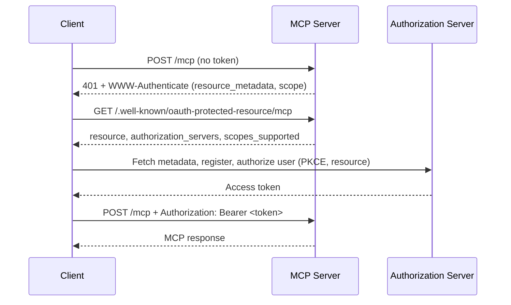

`MCP_AUTH_MODE=oauth` is the recommended way to protect a remote, multi-user deployment. The server follows the [MCP authorization specification](https://modelcontextprotocol.io/specification/2026-07-28/basic/authorization) (revision 2026-07-28) in the role of an **OAuth 2.1 resource server**.

| Mode | Use for |
|------|---------|
| `none` (default) | Local development and stdio. The stdio transport never authenticates. |
| `oauth` | Remote HTTP deployments with more than one user. |
| `ibmi` | Deprecated. See [IBM i Authentication](/server-config/ibmi-auth). |

## What the Server Does

- **Verifies access tokens.** Every request to the MCP endpoint must carry `Authorization: Bearer <token>`. The token must be a JWT issued by your authorization server.
- **Publishes Protected Resource Metadata** ([RFC 9728](https://datatracker.ietf.org/doc/html/rfc9728)) so clients can find the authorization server.
- **Answers with OAuth challenges.** A missing or invalid token gets `401` with a `WWW-Authenticate: Bearer` header. A valid token without a required scope gets `403` with `error="insufficient_scope"`.

The server does **not** issue tokens, register clients, or host a login page. Those belong to your authorization server (identity provider).

<Warning>
**SQL runs as the service account.** An OAuth token identifies the caller only. It carries no IBM i credentials and is never forwarded to IBM i. Every SQL statement runs as `DB2i_USER` (or the user of the YAML source the tool names), whoever the caller is. Grant that profile only the authority every permitted caller may use. The server logs this once at startup.
</Warning>

## Configuration

| Variable | Required | Description |
|----------|----------|-------------|
| `MCP_AUTH_MODE` | Yes | Set to `oauth`. |
| `MCP_RESOURCE_URL` | Yes | Public URL of the MCP endpoint as clients reach it, for example `https://mcp.example.com/mcp`. Must be an `http(s)` URL without a fragment. |
| `OAUTH_ISSUER_URL` | Yes | Issuer of your authorization server. Compared exactly with the token's `iss` claim. Must be `https` unless the host is `localhost`, `127.0.0.1` or `[::1]`. |
| `OAUTH_JWKS_URI` | No | URL of the issuer's JSON Web Key Set. Default: discovered from the issuer's metadata. Same `https` rule as the issuer. |
| `OAUTH_AUDIENCE` | No | Expected `aud` claim. Default: `MCP_RESOURCE_URL`. |
| `OAUTH_REQUIRED_SCOPES` | No | Space-separated scopes every request must carry. Default: none. |

```bash
MCP_TRANSPORT_TYPE=http
MCP_HTTP_HOST=0.0.0.0
MCP_ALLOWED_HOSTS=mcp.example.com

MCP_AUTH_MODE=oauth
MCP_RESOURCE_URL=https://mcp.example.com/mcp
OAUTH_ISSUER_URL=https://auth.example.com
OAUTH_REQUIRED_SCOPES=mcp:tools

# Service account all SQL runs as
DB2i_HOST=ibmi.example.com
DB2i_USER=MCPSVC
DB2i_PASS=...
```

The server validates these settings when the HTTP transport starts. A missing or malformed value stops startup with exit code 1 and a message naming the variable.

<Note>
The server listens on plain HTTP. Put it behind a reverse proxy or ingress that terminates TLS, and add the public hostname to `MCP_ALLOWED_HOSTS`, or requests are refused with `403` by [Host validation](/configuration#server-transport).
</Note>

### JWKS Discovery

When `OAUTH_JWKS_URI` is unset, the server fetches the issuer's metadata at startup and reads `jwks_uri` from it. It tries, in order:

1. `<issuer origin>/.well-known/oauth-authorization-server<issuer path>` (RFC 8414)
2. `<issuer origin>/.well-known/openid-configuration<issuer path>`
3. `<issuer>/.well-known/openid-configuration` (only for an issuer with a path)

Startup fails if no document is found within 5 seconds per URL, if the document's `issuer` is not exactly `OAUTH_ISSUER_URL`, or if it has no `jwks_uri`. Set `OAUTH_JWKS_URI` to skip discovery.

### Resource URL and Audience

MCP clients ask the authorization server for a token for one resource, using the `resource` parameter ([RFC 8707](https://www.rfc-editor.org/rfc/rfc8707.html)) set to the MCP server's URL. The server only accepts tokens whose `aud` claim names it.

- Set `MCP_RESOURCE_URL` to the exact URL users configure in their client, including the path (`/mcp` by default).
- By default the token's `aud` may be `MCP_RESOURCE_URL` with or without a trailing slash.
- If your authorization server puts a different value in `aud` (an API identifier, for example), set `OAUTH_AUDIENCE` to that value. Only that exact string is then accepted.

### Required Scopes

`OAUTH_REQUIRED_SCOPES` applies to the whole MCP endpoint. There are no per-tool scopes. The configured scopes are:

- enforced on every request (`403 insufficient_scope` when one is missing),
- advertised as `scopes_supported` in the Protected Resource Metadata,
- sent in the `scope` parameter of the `WWW-Authenticate` challenge, which clients use to decide what to request.

Scopes are read from the token's `scope` claim (space-separated string) or, if absent, its `scp` claim.

### Token Requirements

| Check | Rule |
|-------|------|
| Format | JWT, verified locally against the issuer's JWKS |
| Algorithm | Asymmetric only: `RS256/384/512`, `PS256/384/512`, `ES256/384/512`, `EdDSA` |
| `iss` | Equals `OAUTH_ISSUER_URL` |
| `aud` | Matches the audience described above |
| `exp` | Required and in the future. `nbf` is honored when present. No clock-skew tolerance. |
| Caller id | `client_id`, else `azp`, else `sub`. At least one must be present. |

Every verification failure returns the same `401` with `error_description="Invalid access token"`. The reason is written to the server log together with a 12-character SHA-256 fingerprint of the token. The token itself is never logged.

## How Clients Discover the Authorization Server

A client that implements MCP authorization needs only the server URL:



The metadata document is served without a token at:

- `/.well-known/oauth-protected-resource`
- `/.well-known/oauth-protected-resource<endpoint path>` (for example `/.well-known/oauth-protected-resource/mcp`)

```json
{
  "resource": "https://mcp.example.com/mcp",
  "authorization_servers": ["https://auth.example.com"],
  "scopes_supported": ["mcp:tools"],
  "bearer_methods_supported": ["header"]
}
```

Client registration (Client ID Metadata Documents, pre-registration, or Dynamic Client Registration) happens between the client and your authorization server. Check which of these your authorization server supports.

For browser-based clients, CORS responses expose the `WWW-Authenticate` header to origins listed in `MCP_ALLOWED_ORIGINS`.

## Worked Example: Generic OIDC Provider

This example assumes an OpenID Connect provider at `https://auth.example.com` and an MCP server reachable at `https://mcp.example.com/mcp`.

<Steps>
  <Step title="Configure the provider">
    - Register the MCP server as an API (resource) whose identifier is `https://mcp.example.com/mcp`, so access tokens carry it in `aud`.
    - Define a scope such as `mcp:tools` and grant it to the users or groups allowed to use the server.
    - Make sure access tokens are JWTs signed with an asymmetric algorithm.
    - Enable a client registration method that your MCP clients support.
  </Step>

  <Step title="Confirm the issuer metadata">
    ```bash
    curl -s https://auth.example.com/.well-known/openid-configuration | jq '{issuer, jwks_uri}'
    ```

    Use the `issuer` value, character for character, as `OAUTH_ISSUER_URL`.
  </Step>

  <Step title="Configure and start the server">
    ```bash
    MCP_AUTH_MODE=oauth
    MCP_RESOURCE_URL=https://mcp.example.com/mcp
    OAUTH_ISSUER_URL=https://auth.example.com
    OAUTH_REQUIRED_SCOPES=mcp:tools
    # Only if the provider cannot put the resource URL in "aud":
    # OAUTH_AUDIENCE=api://ibmi-mcp
    ```

    The startup log contains `OAuth authentication enabled` with the resource, issuer and JWKS URL in use.
  </Step>

  <Step title="Connect a client">
    Add `https://mcp.example.com/mcp` to an MCP client that supports OAuth. The client opens a browser sign-in on first use. See [MCP Clients](/clients/overview#oauth-remote-setup).
  </Step>
</Steps>

## Testing with curl

**1. No token: expect a challenge.**

```bash
curl -i -X POST https://mcp.example.com/mcp \
  -H "Content-Type: application/json" \
  -H "Accept: application/json, text/event-stream" \
  -d '{"jsonrpc":"2.0","id":1,"method":"tools/list"}'
```

```http
HTTP/1.1 401 Unauthorized
WWW-Authenticate: Bearer error="invalid_token", error_description="Missing Authorization header", scope="mcp:tools", resource_metadata="https://mcp.example.com/.well-known/oauth-protected-resource/mcp"

{"error":"invalid_token","error_description":"Missing Authorization header"}
```

**2. Metadata: no token needed.**

```bash
curl -s https://mcp.example.com/.well-known/oauth-protected-resource
```

**3. Valid token: expect the tool list.**

Get an access token from your provider for the resource `https://mcp.example.com/mcp` with the required scopes, then:

```bash
curl -s -X POST https://mcp.example.com/mcp \
  -H "Authorization: Bearer $ACCESS_TOKEN" \
  -H "Content-Type: application/json" \
  -H "Accept: application/json, text/event-stream" \
  -d '{"jsonrpc":"2.0","id":1,"method":"tools/list"}'
```

| Response | Meaning |
|----------|---------|
| `200` with a `tools` result | Token accepted |
| `401` `Invalid access token` | Signature, issuer, audience, expiry or algorithm check failed. The server log has the reason. |
| `403` `insufficient_scope` | Token is valid but lacks a scope from `OAUTH_REQUIRED_SCOPES` |

## Rate Limiting and Logging

- Authenticated requests are rate-limited per token subject (`sub`), then per client id, then per IP address. See [Rate Limiting](/configuration#rate-limiting-http-only).
- Each authenticated request logs the client id, subject and scopes at `info` level.

## Limits

- **JWT access tokens only.** Opaque tokens and token introspection (RFC 7662) are not supported.
- **No per-user IBM i authority.** All SQL runs as the service account (see the warning above).
- **No per-tool scopes.** `OAUTH_REQUIRED_SCOPES` covers the whole endpoint.
- **No clock-skew tolerance.** Keep server and authorization server clocks in sync.
- **One issuer.** The server trusts a single authorization server.
- **HTTP transport only.** The stdio transport does not authenticate.

## Troubleshooting

<AccordionGroup>
  <Accordion title="Startup fails: MCP_RESOURCE_URL / OAUTH_ISSUER_URL is required">
    Both variables are required in `oauth` mode. Startup prints one line on stderr naming the missing variable and exits with code 1.
  </Accordion>

  <Accordion title="Startup fails: No authorization server metadata found">
    The server could not fetch the issuer's metadata. Check that `OAUTH_ISSUER_URL` is exact and reachable from the server, or set `OAUTH_JWKS_URI`.
  </Accordion>

  <Accordion title="Startup fails: Fix the invalid environment variables reported above">
    An environment variable failed validation, which would make every setting fall back to its default (including `MCP_AUTH_MODE=none`). The server refuses to start in that state. Fix the variables reported on stderr.
  </Accordion>

  <Accordion title="Every token is rejected with 401">
    Look for `Access token rejected.` in the server log; its `reason` field holds the verification error code. Common causes: `aud` is not the resource URL (set `OAUTH_AUDIENCE`), `iss` differs from `OAUTH_ISSUER_URL` by a trailing slash, the token is opaque rather than a JWT, or the token is signed with `HS256`.
  </Accordion>

  <Accordion title="403 Forbidden: Host not allowed">
    This is Host validation, not OAuth. Add the public hostname to `MCP_ALLOWED_HOSTS`.
  </Accordion>
</AccordionGroup>

## Next Steps

<CardGroup cols={2}>
  <Card title="Configuration Reference" icon="gear" href="/configuration">
    All environment variables
  </Card>
  <Card title="MCP Clients" icon="plug" href="/clients/overview">
    Connect clients to a remote server
  </Card>
</CardGroup>
