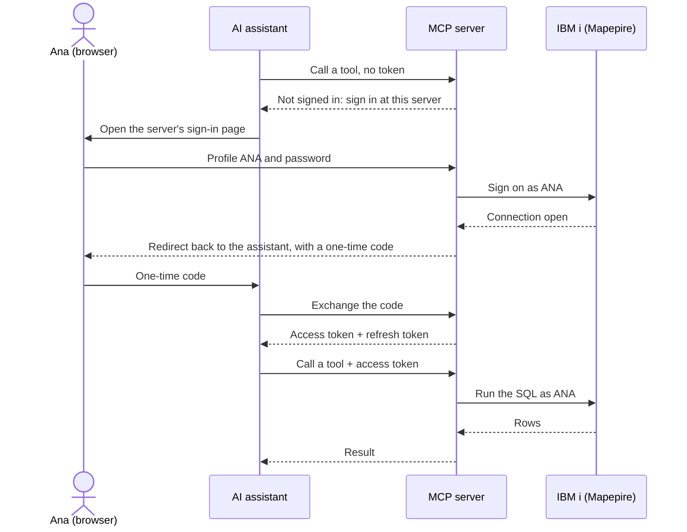

When the MCP server runs over HTTP for a team, it has to know who is calling. OAuth lets each person sign in once in their browser. Their AI assistant then handles everything else.

A server you run only for yourself over stdio doesn't need any of this.

## What OAuth does

Without OAuth, every assistant would need a password or a shared key written into its configuration. With OAuth, nobody puts a secret in a config file. The person signs in on the server's own page, and the assistant gets two tokens in return:

- an **access token**, which it sends with every request and which expires after 15 minutes;
- a **refresh token**, which it uses to get a new access token without asking the person again.

The sign-in lasts 12 hours, or until the server restarts. After that the person signs in again.

The server that runs the sign-in page and hands out tokens is called the **authorization server**. With IBM i sign-on, that's the MCP server itself.

## How it works

Here is what happens the first time Ana adds the server to her assistant and asks it a question. Mapepire is the IBM i database server that the MCP server sends SQL to.

The key step is the sign-on in the middle. The MCP server signs on to the IBM i as `ANA` and keeps that connection, so every tool call Ana makes runs its SQL as her. IBM i authority checks, job logs and auditing all name `ANA`.

When the access token expires, the assistant uses the refresh token to get a new one in the background. Ana only sees the sign-in page again when the sign-in ends.

## Choose how people sign in

| | IBM i sign-on | Your identity provider |
|---|---|---|
| People sign in with | Their IBM i user profile and password | Your company login (Okta, Entra ID, Keycloak, …) |
| SQL runs as | The person who signed in | One service account (`DB2i_USER`) |
| IBM i authority and auditing | Per person | Shared by everyone |
| Fits | People who have IBM i profiles | People without IBM i profiles, unattended agents |

With your identity provider, Ana signs in at the provider instead of the MCP server, and the server never signs on to the IBM i as her.

Choose **IBM i sign-on** unless the people using the server don't have IBM i profiles.

## Next steps

<CardGroup cols={2}>
  <Card title="Set up IBM i sign-on" icon="user-lock" href="/server-config/oauth-ibmi-signon">
    Try it on your machine, then open it to your team.
  </Card>
  <Card title="Use your identity provider" icon="id-badge" href="/server-config/oauth-provider">
    Accept tokens from your existing OAuth or OpenID Connect provider.
  </Card>
  <Card title="Security" icon="shield-check" href="/server-config/oauth-security">
    How people are authenticated, and how to lock the setup down.
  </Card>
  <Card title="Reference" icon="list" href="/server-config/oauth-reference">
    Every setting, default and limit.
  </Card>
</CardGroup>
