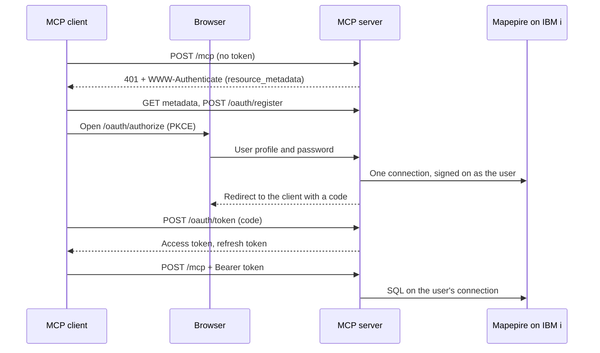
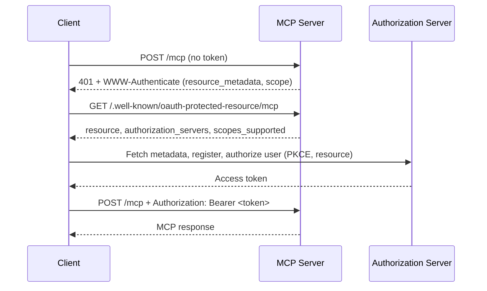

`MCP_AUTH_MODE=oauth` protects a remote, multi-user deployment. The server follows the [MCP authorization specification](https://modelcontextprotocol.io/specification/2026-07-28/basic/authorization) (revision 2026-07-28). It has two flavours, selected by one variable:

| | Built-in IBM i sign-on | External authorization server |
|---|---|---|
| Selected by | `OAUTH_ISSUER_URL` **unset** | `OAUTH_ISSUER_URL` **set** |
| Who signs users in | This server: a sign-in page that takes an IBM i user profile and password | Your identity provider |
| SQL runs as | **The signed-on user profile** | The `DB2i_USER` service account |
| IBM i authority and auditing | Per user | Shared by every caller |
| Service account password on the server | None (`DB2i_PASS` must be unset) | `DB2i_PASS` |
| Access tokens | Opaque, issued by this server | JWTs, issued by your identity provider |
| Fits | People who each have an IBM i profile | Callers without an IBM i profile, unattended agents |

**Built-in IBM i sign-on is the recommended mode for multi-user remote deployments**: object authority, job logs and the audit journal apply to the person who signed on. Read [What It Does Not Protect Against](#what-it-does-not-protect-against) and [What Has and Has Not Been Tested](#what-has-and-has-not-been-tested) before you deploy it.

| `MCP_AUTH_MODE` | Use for |
|------|---------|
| `none` (default) | Local development and stdio. The stdio transport never authenticates. |
| `oauth` | Remote HTTP deployments with more than one user. |
| `ibmi` | Deprecated. See [IBM i Authentication](/server-config/ibmi-auth). |

## Built-in IBM i Sign-On

With `MCP_AUTH_MODE=oauth` and no `OAUTH_ISSUER_URL`, the server is its own OAuth 2.1 authorization server. An MCP client sends the user's browser to a sign-in page this server serves. The user types an IBM i user profile and password there. Every tool, built-in and YAML, then runs its SQL on a Mapepire connection signed on as that user. There is no service account.

### How It Works



- **One sign-on is one connection.** Submitting the form makes exactly one sign-on attempt on the IBM i. On success the open connection (one IBM i database server job) belongs to that sign-on. Nothing is retried.
- **The password is not kept in clear.** Before the server drops the typed password it encrypts it. The key is never stored in clear either: it is kept only wrapped under a key derived from the authorization code and then from the client's current refresh token. The server alone cannot decrypt the password.
- **Idle connections are closed.** After `OAUTH_IDLE_CLOSE_MINUTES` (default 10) without a request to the MCP endpoint, the server closes the connection and its IBM i job ends. A token refresh is not such a request: a client that only refreshes is closed as idle too. The sign-on itself stays.
- **A token refresh reopens the connection.** The next request gets `401` with `error_description="connection closed, refresh"`. The client presents its refresh token at `/oauth/token`. That token unwraps the key, the server decrypts the password, makes one sign-on attempt, and erases the decrypted bytes. The user is not prompted. The new connection is a new IBM i job, and it gets a full idle period.
- **A sign-on lasts at most `OAUTH_GRANT_MAX_HOURS`** (default 12). After that the user signs on again.
- **Nothing is written to disk.** A restart of the server signs everyone out.

Access tokens live `OAUTH_IDLE_CLOSE_MINUTES` plus five minutes (15 minutes by default). They carry no key material: an access token alone cannot reopen a closed connection.

### What Is Stored Where

**In the MCP server process (memory only):**

| Item | Form | Lifetime |
|------|------|----------|
| Password | AES-256-GCM ciphertext under a random key made for that sign-on | Until the sign-on ends, then overwritten with zeros |
| That key | Only wrapped (AES-256-GCM) under a key derived with HKDF-SHA256 from the authorization code (60 seconds), then the current refresh token, and the previous refresh token until it is retired | In clear only while sealing, re-wrapping or reconnecting |
| Authorization codes, access tokens, refresh tokens | SHA-256 hashes, plus the replay record below | Until they expire or the sign-on ends |
| Replay record of the last refresh | The new access token and the new refresh token, AES-256-GCM under a key derived with HKDF-SHA256 from the previous refresh token. The server alone cannot open it. | Until the previous refresh token is retired |
| The open connection | A WebSocket to Mapepire. It holds no user name and no password. | While the user is active, plus the idle time |
| Sign-on failure counters | Keyed by an HMAC of the profile name under a random per-process key | Until a success, an unblock or a restart |

The typed password exists in clear as bytes during the sign-on request and during each reconnect. The copies the server's own code makes are kept outside the JavaScript heap and outside Node.js's shared buffer pool, and are overwritten with zeros when the request finishes. Authorization codes and refresh tokens a client presents are handled the same way. Memory the server's own code does not hold is not overwritten:

- **Node.js's HTTP read buffer.** Node.js reads every incoming request into one buffer that lives as long as the process and is reused without being cleared. The body of the last sign-in form, password included, stays in it until a later request at least as long overwrites it. The same holds for the body of the last token request, with its authorization code or refresh token. On a quiet server that is the password of the last user who signed on, for as long as the process runs. This was observed with the plain-HTTP listener (a proxy in front); the server's own TLS listener was not examined.
- **Buffers inside Node.js's crypto and TLS code**, for example the copy a key derivation makes of a code or a refresh token, are freed or left to the garbage collector, not overwritten.
- **One string.** The server builds the `Authorization` header of the WebSocket upgrade from the password. A string cannot be overwritten; nothing refers to it after the request is sent.

The server holds no service account password, no token-signing key and no encryption key at rest. When `MCP_TLS_KEY_FILE` is set it holds the private key of its own TLS listener.

**On the wire:**

- Browser to server: the password once per sign-on, in the body of the form `POST`, inside TLS. It is never in a URL. A TLS-terminating proxy in front of the server sees it in clear.
- Server to Mapepire: `Authorization: Basic` on one WebSocket upgrade per connection, inside TLS. The server verifies Mapepire's certificate first, unless `DB2i_IGNORE_UNAUTHORIZED=true` turns that off (see [Setup](#setup)). It is sent again at each reconnect.
- Client to server: the access token on every MCP request, the refresh token only in `/oauth/token` request bodies.

**On the IBM i:**

<Warning>
**mapepire-server keeps each connected user's password in the memory of its Java job for as long as that user's connection is open.** This server cannot change that. It limits the time: a connection is open while the user is working, plus `OAUTH_IDLE_CLOSE_MINUTES`. Whoever can dump or control the Mapepire job on the IBM i can read the passwords of the users connected at that moment, without touching the MCP server.

This statement, and the IBM i setup below that follows from it, come from reading the mapepire-server 2.5.1 source and IBM documentation. They were not tested on an IBM i system for this release.
</Warning>

Each connection runs in a database server job under the user's own profile. No secret of the MCP server is stored on the IBM i.

**In the MCP client:** the access token and the refresh token. The refresh token is one half of what is needed to decrypt the stored password. Alone it yields access tokens, never the password.

**In the user's browser:** nothing from this server. The browser may offer to save the password for the sign-in page's origin.

### What an Attacker Needs to Recover a Password

After a user has signed on, recovering that user's password takes one of:

- code execution inside the MCP server process while the user is connected, or when the user's client next refreshes;
- a dump of the Mapepire job on the IBM i while the user's connection is open;
- a full memory image of the MCP server process that still contains a current or previous refresh token of that sign-on next to the ciphertext, or the password itself: in freed memory that was not reused yet, or in Node.js's HTTP read buffer, which holds the last sign-in form until a longer request overwrites it;
- a memory image taken while a connection is open, together with a recording of that connection's TLS traffic;
- with `DB2i_IGNORE_UNAUTHORIZED=true`: a position on the network between the server and the IBM i, from which to answer in Mapepire's place;
- the user's browser password store, if the user saved the password there.

Not enough on their own: an access token; a refresh token, which opens the stored password only together with the server's memory; and the server's log files, its disk, a backup or its container image, which hold no password, ciphertext or key. A test in this repository (`packages/server/tests/ibmi-mcp-server/oauth/memory.test.ts`) takes a V8 heap snapshot after a sign-on, a tool call, an idle close and a refresh, and checks that no string in it contains the test password or a refresh token.

### What It Does Not Protect Against

- **Code execution in the MCP server process, or root on its host or on a TLS-terminating proxy in front of it.** That attacker can run SQL on every open connection, capture passwords typed while present, and decrypt a stored password as soon as its client refreshes.
- **Someone on the IBM i who can dump or control the Mapepire job**, and an administrator of the IBM i or of mapepire-server. They receive every password at sign-on and at each reconnect.
- **Anyone who can impersonate the Mapepire server, when `DB2i_IGNORE_UNAUTHORIZED=true`.** The server then sends each password, at sign-on and at every reconnect, to whatever answers at `DB2i_HOST`, without checking its certificate. Someone on the network path, or who controls name resolution or routing for that host, receives the passwords in clear.
- **A full memory image or core dump of the server.** It can hold the password of the last user who signed on, however long ago that was (see Node.js's HTTP read buffer under [What Is Stored Where](#what-is-stored-where)), and what it takes to decrypt the stored password of a user who signed on or refreshed recently. Disable core dumps for the service or container.
- **A sign-in link built by an attacker who shares the victim's network address** (same machine, same NAT or VPN address) or who runs a program on the victim's machine. For other attackers the code exchange is bound to the address that signed on; that binding does not apply when you set `OAUTH_CODE_ADDRESS_BINDING=audit` or list a non-loopback redirect URI.
- **A stolen access token** while the connection is open and the token is unexpired: SQL as that user. **A stolen refresh token**: SQL as that user until `OAUTH_GRANT_MAX_HOURS` or revocation.
- **Hostile SQL in a YAML tool file.** It runs with the signed-on user's authority.
- **Statements that keep running.** A statement abandoned after 120 seconds may continue on the IBM i.
- **Someone inside the allowed network blocking sign-on for a named profile** by submitting wrong passwords (see [Sign-On Budget and Unblocking](#sign-on-budget-and-unblocking)). A restart refills the budget, so two rejected attempts, a restart and one more can add up to three failed sign-ons on the IBM i.
- **More failed sign-ons than `OAUTH_SIGNON_MAX_FAILURES` when Mapepire's answers cannot be read.** While Mapepire answers a sign-on late, drops the connection or answers with a text the server does not recognise, the server forwards up to twice `OAUTH_SIGNON_MAX_FAILURES` attempts for a profile (4 by default) before it blocks the profile, and each may have been counted as failed on the IBM i.
- **One failed sign-on on the IBM i when a password is changed** while no connection is open and the user has not signed on here again: the next reconnect uses the old password, is rejected, and ends the sign-ons of that profile that hold that password. If Mapepire does not answer that reconnect, or answers with a text the server does not recognise, the old password is sent a second time before those sign-ons end. A new sign-on with the new password ends the earlier sign-ons first, so nothing stale is sent.
- **A look-alike sign-in page on another origin**, and passwords saved in a browser.

### Requirements

- **HTTP transport.** The stdio transport cannot be used.
- **TLS between the browser and the server**: the server's own TLS listener, or a TLS-terminating proxy on the same host.
- **mapepire-server 2.x**, reachable over TLS. No version is required or checked: the server never asks Mapepire for its version. The mode was checked against mapepire-server 2.3.2 and against the 2.4 and 2.5 sources. Recommended, not enforced: run 2.3.2 or later, because earlier 2.x builds let any connected client read other connections' trace output.
- **`DB2i_HOST`** set to the one IBM i users sign on to. A host name or an IPv4 address; an IPv6 literal is not supported.
- **`DB2i_PASS` unset.**
- **One server process.** Sign-ons are held in memory and are not shared between instances.
- **Node.js 22.17 or later**, started without `--inspect`.
- The [IBM i setup](#ibm-i-setup) below.

### Setup

<Steps>
  <Step title="Give the server TLS">
    Users type their IBM i password into a page this server serves, so the server refuses to listen for it in clear on a network interface. Choose one:

    **The server terminates TLS itself.** Set `MCP_TLS_CERT_FILE` and `MCP_TLS_KEY_FILE` to PEM files (certificate chain and private key). The server then listens with HTTPS and `MCP_HTTP_HOST` may be a non-loopback address.

    ```bash
    MCP_HTTP_HOST=0.0.0.0
    MCP_TLS_CERT_FILE=/etc/ibmi-mcp/server.crt
    MCP_TLS_KEY_FILE=/etc/ibmi-mcp/server.key
    ```

    **A TLS-terminating proxy on the same host.** Keep `MCP_HTTP_HOST=127.0.0.1` (the default) so that only the proxy can reach the server, and list the proxy in `MCP_TRUSTED_PROXIES`. The server refuses to start without it: with a public `MCP_RESOURCE_URL`, a loopback `MCP_HTTP_HOST` and no TLS listener, a proxy is certainly in front.

    ```bash
    MCP_HTTP_HOST=127.0.0.1
    MCP_TRUSTED_PROXIES=127.0.0.1   # add ::1 if the proxy connects over IPv6
    ```

    A proxy on **another** host (a load balancer, an OpenShift Route) must re-encrypt: give the server its own TLS listener as well, and list the proxy's address in `MCP_TRUSTED_PROXIES`. See [OpenShift](/deployment/openshift#built-in-ibm-i-sign-on).
  </Step>

  <Step title="Configure the proxy, if there is one">
    The proxy must:

    - **set `X-Forwarded-For` itself** (overwrite it with the client address, or append the client address);
    - be listed in `MCP_TRUSTED_PROXIES` by address or CIDR range;
    - forward these paths unchanged: the MCP endpoint (`/mcp`), `/oauth/authorize`, `/oauth/token`, `/oauth/revoke`, `/oauth/register`, `/.well-known/oauth-protected-resource` (and the same with the endpoint path appended) and `/.well-known/oauth-authorization-server`;
    - leave the `Origin` request header and the response headers of the sign-in page (`Content-Security-Policy`, `Referrer-Policy`) alone. The form is refused when its `Origin` is not the public origin of the server, and a page served under `Referrer-Policy: no-referrer` posts `Origin: null`.

    The sign-in page and the token endpoint refuse a request whose forwarding headers do not match `MCP_TRUSTED_PROXIES`: one that carries `X-Forwarded-For`, `Forwarded` or `X-Real-IP` but does not come from a listed proxy, and one from a listed proxy without a usable `X-Forwarded-For` entry. See [Behind a Reverse Proxy](/configuration#behind-a-reverse-proxy) for how the client address is chosen.

    <Warning>
    A proxy that is **not** listed and sends **no** forwarding header is invisible to the server: every user then appears at the proxy's address. The limits that depend on the address (`OAUTH_SIGNON_ALLOWED_CIDRS`, the code address binding, the per-address rate limit) stop telling users apart, and a proxy on the same host makes every user look like a local one, whom the default `OAUTH_SIGNON_ALLOWED_CIDRS` admits. Always have the proxy set `X-Forwarded-For` and list it.

    The server detects a missing entry in one case only: a public `MCP_RESOURCE_URL` served from a loopback `MCP_HTTP_HOST` without a TLS listener, where it refuses to start until `MCP_TRUSTED_PROXIES` is set. It cannot detect a proxy on another host in front of its own TLS listener, or a container runtime that replaces client addresses (see [Docker](/deployment/docker#built-in-ibm-i-sign-on)).
    </Warning>
  </Step>

  <Step title="Tell the server how to verify the Mapepire certificate">
    The connection to Mapepire carries the password. Unless you turn it off, the server verifies Mapepire's certificate before it sends anything. Set at most one of:

    | Variable | Trusts | Host name check |
    |----------|--------|-----------------|
    | `DB2i_SERVER_CERT_FILE` | Exactly the certificate in this PEM file (a pin). Works for Mapepire's self-signed certificate and for a host addressed by IP. An expired certificate is refused. | No |
    | `DB2i_CA_FILE` | Certificates issued by the CA in this PEM file | Yes |
    | neither | Node.js's built-in trust store | Yes |
    | `DB2i_IGNORE_UNAUTHORIZED=true` | Any certificate: expired, self-signed, or issued for another host | No |

    <Warning>
    **`DB2i_IGNORE_UNAUTHORIZED=true` turns verification off.** The passwords users type on the sign-in page are then sent to a server whose identity is not checked: anyone who can answer in Mapepire's place on the network receives them. The server logs one warning at startup saying so. Use it only where you accept that risk, for example on a test system; otherwise pin the certificate with `DB2i_SERVER_CERT_FILE` or name its CA with `DB2i_CA_FILE`.

    In this mode only an explicit `true` (or `1`) turns verification off. Unset, or `false`, the certificate is verified. `DB2i_IGNORE_UNAUTHORIZED=true` together with `DB2i_SERVER_CERT_FILE` or `DB2i_CA_FILE` stops startup, because the two contradict each other. `.env.example` ships with `DB2i_IGNORE_UNAUTHORIZED=true` for the service-account setup: delete that line from a copied `.env` when you want the certificate verified.
    </Warning>

    Export the certificate on the IBM i from the keystore Mapepire uses. If you fetch it over the network instead, compare its fingerprint with the one on the IBM i before you trust it: whoever can replace this file can stand between the server and the IBM i and receive passwords.

    ```bash
    openssl x509 -in /etc/ibmi-mcp/mapepire.crt -noout -fingerprint -sha256
    ```

    A pinned certificate must be replaced here whenever Mapepire's certificate is renewed.
  </Step>

  <Step title="Configure and start the server">
    ```bash
    MCP_TRANSPORT_TYPE=http
    MCP_AUTH_MODE=oauth
    # No OAUTH_ISSUER_URL: that selects the built-in sign-on.
    MCP_RESOURCE_URL=https://mcp.example.com:3010/mcp   # public URL of the MCP endpoint
    MCP_ALLOWED_HOSTS=mcp.example.com

    MCP_HTTP_HOST=0.0.0.0
    MCP_TLS_CERT_FILE=/etc/ibmi-mcp/server.crt
    MCP_TLS_KEY_FILE=/etc/ibmi-mcp/server.key

    DB2i_HOST=ibmi.example.com          # no DB2i_USER, no DB2i_PASS
    DB2i_SERVER_CERT_FILE=/etc/ibmi-mcp/mapepire.crt

    OAUTH_ADMIN_SOCKET=/run/ibmi-mcp/admin.sock
    ```

    Delete the `DB2i_USER` and `DB2i_PASS` lines from an `.env` file copied from `.env.example`; a line left blank (`DB2i_PASS=`) is rejected as an invalid value. Delete `DB2i_IGNORE_UNAUTHORIZED=true` too: with a certificate file it stops startup, and without one it turns certificate verification off.

    The server does not contact Mapepire at startup. A wrong `DB2i_HOST`, a closed port or a certificate that does not verify shows only at the first sign-on, as "The IBM i system is unavailable" on the page and `signon_unavailable` in the log.

    `MCP_RESOURCE_URL` is the URL users configure in their client. It must use `https` unless its host is `localhost`, `127.0.0.1` or `[::1]`. The address of the authorization server (the issuer) is derived from it by dropping the last path segment: `https://mcp.example.com:3010/mcp` gives `https://mcp.example.com:3010`.

    If the public URL has a path prefix (`https://apps.example.com/ibmi/mcp`), the issuer is `https://apps.example.com/ibmi`, the OAuth endpoints are under `/ibmi/oauth/`, the proxy must forward the paths with the prefix, and `MCP_HTTP_ENDPOINT_PATH` must be the path the server receives (`/ibmi/mcp`).

    The startup log contains `Built-in OAuth authorization server enabled. Users sign on with their IBM i profile and all SQL runs as the signed-on user.`
  </Step>

  <Step title="Verify">
    ```bash
    # The MCP endpoint names this server as its authorization server
    curl -s https://mcp.example.com:3010/.well-known/oauth-protected-resource/mcp

    # The authorization server's metadata
    curl -s https://mcp.example.com:3010/.well-known/oauth-authorization-server

    # Counts of sign-ons and connections (no profile names)
    curl -s https://mcp.example.com:3010/healthz
    ```

    `/healthz` reports `signOn: { grants, openConnections, maxConnections, blockedProfiles }` in this mode instead of `pools`.

    Then add `https://mcp.example.com:3010/mcp` to an MCP client, without an `Authorization` header. See [Clients](#clients).
  </Step>
</Steps>

### Settings

Every variable below applies to the built-in sign-on only, except where noted.

| Variable | Default | Effect |
|----------|---------|--------|
| `MCP_RESOURCE_URL` | (none, required) | Public URL of the MCP endpoint. `https`, or `http` on a loopback host. The issuer is this URL without its last path segment. Also used by the external flavour. |
| `DB2i_HOST`, `DB2i_PORT` | port `8076` | The IBM i users sign on to, and its Mapepire port. The host is never taken from a request or from a YAML file. |
| `DB2i_SERVER_CERT_FILE` | (none) | PEM file with the exact certificate Mapepire presents. Host name not checked. |
| `DB2i_CA_FILE` | (none) | PEM file with the CA that issued Mapepire's certificate. Host name checked. Not together with `DB2i_SERVER_CERT_FILE`. |
| `DB2i_IGNORE_UNAUTHORIZED` | unset: the certificate is verified | `true` (or `1`) sends passwords to Mapepire without verifying its certificate, and logs a warning at startup. Not together with `DB2i_SERVER_CERT_FILE` or `DB2i_CA_FILE`. The default of `true` that applies to service-account connections does not apply here. |
| `DB2i_JDBC_OPTIONS` | (none) | Connection options of every user's job. Only `naming`, `libraries`, `date format`, `date separator`, `time format`, `time separator`, `decimal separator`, `transaction isolation` and `access` are allowed; any other key stops startup. The server itself always sends `prompt=false` first; `prompt` cannot be set here. |
| `MCP_TLS_CERT_FILE`, `MCP_TLS_KEY_FILE` | (none) | PEM certificate (chain) and private key of the server's own HTTPS listener. Set both or neither. Required unless `MCP_HTTP_HOST` is a loopback address. Usable in every auth mode. |
| `MCP_TRUSTED_PROXIES` | (none) | Addresses or CIDR ranges of the reverse proxies in front of the server. Required here when `MCP_RESOURCE_URL` is not a loopback URL, `MCP_HTTP_HOST` is a loopback address and there is no TLS listener. Applies to every auth mode; see [Behind a Reverse Proxy](/configuration#behind-a-reverse-proxy). |
| `OAUTH_SIGNON_ALLOWED_CIDRS` | `127.0.0.0/8`, `::1/128`, `10.0.0.0/8`, `172.16.0.0/12`, `192.168.0.0/16`, `fc00::/7` | Client addresses that may open and submit the sign-in page. Others get a `403` page. Setting it replaces the default list. Keep it to networks that may already reach the IBM i's own sign-on. |
| `OAUTH_CODE_ADDRESS_BINDING` | `strict` | For a loopback redirect, the authorization code must be redeemed from the address that signed on. `strict`: a mismatch ends the sign-on. `audit`: a mismatch is only logged (`signon_source_mismatch`). All loopback addresses count as equal. |
| `OAUTH_GRANT_MAX_HOURS` | `12` | Longest a sign-on lasts. Also the longest the encrypted password exists. |
| `OAUTH_IDLE_CLOSE_MINUTES` | `10` | Idle minutes after which a user's connection is closed. Access tokens live this long plus five minutes. A higher value means fewer reconnects, and a longer-lived password copy in the Mapepire job. |
| `OAUTH_MAX_CONNECTIONS` | `50` | Most IBM i connections (jobs) open at once. At the limit a sign-on is refused with a "try again later" page and a refresh that would need a new connection gets `429`. |
| `OAUTH_ALLOWED_PROFILES` | every profile not starting with `Q` | Comma-separated profiles that may sign on: exact names, or the start of a name followed by `*` (`DEV*`). A profile starting with `Q` may sign on only when it is listed by its exact name. |
| `OAUTH_ALLOW_PRIVILEGED_PROFILES` | `false` | Let profiles that hold `*ALLOBJ` or `*SECADM` special authority sign on. |
| `OAUTH_SIGNON_MAX_FAILURES` | `2` | Rejected sign-ons in a row after which a profile is blocked on this server: the most sign-ons this server forwards for one profile that the IBM i is known to have rejected. Sign-ons whose result the server could not read block the profile at twice this number. Minimum 1. Check it against the IBM i system values `QMAXSIGN` and `QMAXSGNACN`; see [Sign-On Budget and Unblocking](#sign-on-budget-and-unblocking). |
| `OAUTH_ALLOW_LOOPBACK_REDIRECTS` | `true` | Accept redirect URIs `http://localhost`, `http://127.0.0.1` and `http://[::1]` on any port and path, as desktop clients use. Set it to `false` on hosts shared by several users. |
| `OAUTH_REDIRECT_URIS` | (none) | Redirect URIs accepted besides loopback ones, separated by commas or spaces. Each is matched exactly. |
| `OAUTH_ADMIN_SOCKET` | (none) | Path of the local admin socket. See [Sign-On Budget and Unblocking](#sign-on-budget-and-unblocking). |

Fixed values, not settings:

| Value | |
|-------|---|
| Authorization code | 60 seconds, single use, PKCE `S256` only |
| Sign-in page | Valid for 10 minutes, one sign-on. A second submission of the same form from the same address (a double click) gets the answer of the first, while that sign-on runs and for 5 seconds after; later ones are refused. |
| Sign-ons per profile | 5; one more ends the least recently used one |
| Sign-ons in total | 1,000 |
| Statements per sign-on | One at a time, up to 8 waiting; a further one is refused |
| Statement time limit | 120 seconds, then the statement is abandoned and the connection closed. `MCP_POOL_QUERY_TIMEOUT_MS` and `MCP_POOL_IDLE_TIMEOUT_MS` do not apply. |
| Refresh rotations per sign-on | 12 in 5 minutes, then `429` |
| Liveness | A WebSocket ping every 60 seconds; three unanswered pings in a row close the connection |

`OAUTH_JWKS_URI` and `OAUTH_AUDIENCE` belong to the external flavour and stop startup here. `OAUTH_REQUIRED_SCOPES` has no effect: the built-in authorization server knows one scope, `offline_access`, which every token response names, and the MCP endpoint checks none.

### What Stops Startup

In this mode the server exits with code 1 and a message naming the setting when:

- `MCP_RESOURCE_URL` is missing, has a fragment, or is not `https` and not a loopback `http` URL;
- the transport is stdio;
- `MCP_HTTP_HOST` is not a loopback address and `MCP_TLS_CERT_FILE` / `MCP_TLS_KEY_FILE` are not set;
- `MCP_RESOURCE_URL` is not a loopback URL, `MCP_HTTP_HOST` is a loopback address, no TLS listener is set and `MCP_TRUSTED_PROXIES` is empty: a proxy on the same host is then in front of the server and has to be named;
- only one of `MCP_TLS_CERT_FILE` and `MCP_TLS_KEY_FILE` is set, or the files do not hold a certificate and its key;
- `DB2i_HOST` is not set;
- `DB2i_PASS` is set;
- `DB2i_IGNORE_UNAUTHORIZED=true` is set together with `DB2i_SERVER_CERT_FILE` or `DB2i_CA_FILE`;
- both `DB2i_SERVER_CERT_FILE` and `DB2i_CA_FILE` are set, or the file cannot be read or holds no certificate;
- `DB2i_JDBC_OPTIONS` has a key outside the list above (`prompt` included);
- `OAUTH_JWKS_URI` or `OAUTH_AUDIENCE` is set;
- `IBMI_HTTP_AUTH_ENABLED=true`;
- the Node.js inspector is active (`--inspect`);
- an entry of a list setting is malformed (`MCP_TRUSTED_PROXIES`, `OAUTH_SIGNON_ALLOWED_CIDRS`, `OAUTH_ALLOWED_PROFILES`, `OAUTH_REDIRECT_URIS`);
- `OAUTH_ADMIN_SOCKET` names a path that exists and is not a socket, a socket another server is listening on, or a path where no socket can be created;
- a YAML source names a host other than `DB2i_HOST` or sets `jdbc-options`, or a tool file names an environment variable other than `DB2i_HOST` and `DB2i_PORT` (see [YAML Tools](#yaml-tools)).

### Sign-On Budget and Unblocking

The IBM i acts on a profile after `QMAXSIGN` failed sign-ons; what it does (disable the profile, the device, or both) is the system value `QMAXSGNACN`. The server keeps its own, smaller budget per profile, which bounds how many failed sign-ons the sign-in page can add to that count.

<Warning>
`OAUTH_SIGNON_MAX_FAILURES` bounds how many rejected sign-ons **this server forwards** for one profile. It may not equal what the IBM i counts. Reading the mapepire-server source (every 2.x release except 2.3.6) suggests that one rejected `connect` may be tried by more than one registered JDBC driver, so the IBM i may count more than one failed attempt for one wrong password. This has not been confirmed on a system. Check `QMAXSIGN` and `QMAXSGNACN` on your IBM i before you rely on the default.
</Warning>

| Result of a sign-on attempt | Counted | What the page says |
|-----------------------------|---------|--------------------|
| The IBM i rejected it (wrong password, unknown profile) | Yes | `Sign-on not accepted.` |
| Password expired, profile disabled (recognised only when the Mapepire job runs in English) | No | Says which, and what to do |
| Mapepire itself refused the profile | No | Not permitted through Mapepire |
| IBM i unreachable before a connection opened | No | System unavailable |
| Connection opened, then no answer in 20 seconds, the connection dropped, or an error the server does not recognise | Soft count, and towards the block at twice the maximum: the IBM i may have counted a failed sign-on | System unavailable |
| Profile or password has a shape that cannot sign on (see [Limitations](#limitations)) | No, nothing is sent | Says which rule |

- **Hard budget.** After `OAUTH_SIGNON_MAX_FAILURES` (default 2) rejected attempts with no success between them, nothing more is sent to the IBM i for that profile. The count does not decay with time. Reconnects count too.
- **Results the server could not read.** A sign-on that was sent and then not answered, dropped, or answered with an error the server does not recognise may have been counted as failed on the IBM i. These results are counted together with the rejections, also without decay: after twice `OAUTH_SIGNON_MAX_FAILURES` sign-ons (default 4) with no success between them the profile is blocked in the same way. With the defaults the server forwards at most 2 sign-ons that the IBM i rejected and at most 4 that it may have rejected, until the profile is unblocked or the server restarts. Where `QMAXSIGN` is 3 and 4 is too many, set `OAUTH_SIGNON_MAX_FAILURES=1`: the bounds are then 1 and 2.
- **Soft budget.** Two soft-counted results in 30 minutes pause that profile for 30 minutes.
- **Reconnects with a stored password.** Two reconnects of one profile in a row whose result the server could not read end the sign-ons of that profile that hold the same password, so that password is not sent a third time.
- **One at a time.** One sign-on per profile and four in total may be in flight; another gets "Another sign-on is in progress".
- **10,000 profiles.** The server keeps counts for at most 10,000 profiles. When it holds that many, the oldest one that is not blocked is forgotten to make room, so that sign-on attempts for made-up profile names cannot shut other users out. A blocked profile is never forgotten.

A blocked user sees: *Sign-on for this user profile is blocked on this server after sign-on attempts that were rejected or not answered. The IBM i profile is not disabled by this block. Sign on at a 5250 session first, then ask the operator of this server to unblock the profile.* Signing on at a 5250 session first resets the IBM i's own count.

A block is cleared by `unblock` on the admin socket or by a restart of the server. Without `OAUTH_ADMIN_SOCKET`, only a restart clears it.

**The admin socket** is a Unix domain socket at the path in `OAUTH_ADMIN_SOCKET`, created with access for the owner only. That file permission is the authorization: there is no admin password and no HTTP route. The directory must exist and be writable by the server, and the path must be at most about 100 bytes long. Each server needs a path of its own: a server refuses to start when another one is listening on its `OAUTH_ADMIN_SOCKET`.

Send it a command with the server binary, as the same user and with the same `OAUTH_ADMIN_SOCKET` (from the environment or the server's `.env`):

```bash
ibmi-mcp-server --admin "status"
ibmi-mcp-server --admin "unblock MYUSER"
ibmi-mcp-server --admin "revoke MYUSER"       # every sign-on of the profile
ibmi-mcp-server --admin "revoke <grantId>"    # one sign-on
```

| Command | Reply |
|---------|-------|
| `status` | `grants=3 connections=2/50 blocked=1` |
| `unblock <profile>` | `unblocked`, or `not blocked` |
| `revoke <profile\|grantId>` | `revoked 2` (the number of sign-ons ended) |

A reply that starts with `error:` and a socket that does not answer within 5 seconds give exit code 1. In a container, run it inside the container: `docker exec <container> node packages/server/dist/index.js --admin "status"`.

`revoke` ends the sign-on at once: the encrypted password is erased, the tokens stop working and the IBM i job is closed. To cut a user off for good, also disable the profile on the IBM i.

### IBM i Setup

Because mapepire-server holds the password of every connected user in its job, the following is required on the IBM i, not optional:

- **Run Mapepire under a dedicated user profile** that nobody signs on as.
- **Exclude `*PUBLIC`** from that profile's home directory and its `.mapepire` directory, and **change the keystore passwords** from the published default. Whoever can read the keystore can impersonate the Mapepire server.
- **Export the certificate you pin on the IBM i** from that keystore; do not fetch it over the network.
- **Exclude `*PUBLIC` from the directories JVM dumps are written to.** Remove `*PUBLIC` authority from the `GENJVMDMP` command and from `QSYS2.SET_JVM` unless the site needs them, and **review who holds `*JOBCTL`**: according to IBM's documentation that special authority is enough to dump another job's JVM.
- **Do not start Mapepire with `-Dcodeserver.jdbc.autoconnect=true`.** According to the mapepire-server source, releases 2.3.2 to 2.4.x then sign on again with the same wrong password when the socket closes, so one wrong password costs a second failed sign-on. This server cannot see that setting.
- **Leave Mapepire's trace levels at their defaults**, and run mapepire-server 2.3.2 or later: earlier 2.x builds let any connected client read other connections' trace output.
- **Check `QMAXSIGN` and `QMAXSGNACN`** against `OAUTH_SIGNON_MAX_FAILURES`; see [Sign-On Budget and Unblocking](#sign-on-budget-and-unblocking).
- **Tell users which passwords cannot be used here**: one that contains `:` or `%`, or begins with `*` (see [Limitations](#limitations)).
- **Leave `OAUTH_ALLOW_PRIVILEGED_PROFILES` off** unless you accept that a security officer's password sits in the Mapepire job while that officer is connected.

On the MCP server host: run the server under its own user, mount the certificate and tool files read-only, and disable core dumps.

**What the security officer sees.** Each connection is a database server job under the user's own profile, so authority checks, job logs and object auditing name the user. A user who works in bursts produces a new job after each idle close. The connect request names the application `ibmi-mcp/<grantId>`, and the same `grantId` is in the server's log lines, which joins an IBM i job to the MCP client, the redirect destination and the user's network address. According to the mapepire-server source, Mapepire connects to the database on `localhost`, so exit programs and rules that look at the client's IP address see a local connection, not the user's address.

### YAML Tools

Every tool runs on the connection of the user who calls it, whatever `source` it names:

- A source's `user` and `password` are ignored. `${DB2i_USER}` and `${DB2i_PASS}` in those two fields need not be set, so existing tool files load unchanged.
- A source's `host` must be `DB2i_HOST` (write `${DB2i_HOST}`). Another host stops startup.
- A source must not set `jdbc-options`. Use `DB2i_JDBC_OPTIONS`, which applies to every user's connection.
- A source's `port` and `ignore-unauthorized` are not used: connections go to `DB2i_PORT`, and whether the certificate is verified is decided by the `DB2i_*` settings alone (see [Setup](#setup)).
- `${VAR}` is replaced only for `DB2i_HOST` and `DB2i_PORT`. Any other variable in a tool file (in a statement, a description, a source's `host`) stops startup, whether it is set or not: what a tool file says reaches every signed-on user who calls the tool, so it cannot read the server's environment. In a source's `user` and `password`, which are ignored, another variable is left as written.

A tool call without a sign-on never falls back to a service account: no connection pool exists in this mode. The built-in tools work the same way. `execute_sql` keeps its read-only default (`IBMI_EXECUTE_SQL_READONLY`), on top of what the user's own authority allows.

State a statement leaves on the job (`QTEMP`, the current schema, a changed library list) lasts only until the connection is closed, which happens after every idle period.

### Clients

A client needs only the server URL. It discovers the authorization server from the `401` challenge, registers itself, and opens the sign-in page in the user's browser.

- **Client identity is not verified.** A client is known by an id from `POST /oauth/register` (it starts with `self.`) or by an `https` URL used as its id (Client ID Metadata Document style; the URL is never fetched). Neither is a secret. The sign-in page shows the client's name as "not verified".
- **What protects the user is where the result may be sent.** The authorization code goes only to a loopback address on the user's own machine (`http://localhost`, `http://127.0.0.1`, `http://[::1]`), or to a URI you listed in `OAUTH_REDIRECT_URIS`. The sign-in page shows that destination. After the sign-on the browser is redirected there (`303`); for an `https` destination and for `http://[::1]` it gets a small page that redirects instead, because a browser would not follow a redirect of the form post to them.
- **Registration keeps the allowed redirect URIs and drops the rest**, up to five. It is refused only when none is allowed.
- **A hosted client or a web-based redirect** (a callback on a vendor's domain) works only after you list its exact redirect URI in `OAUTH_REDIRECT_URIS`. For such a destination the code address binding does not apply, and the tokens are held by that vendor.
- **A client that runs on a different machine than the browser** (a remote development session, for example) is refused at the code exchange under `OAUTH_CODE_ADDRESS_BINDING=strict`, because the code is redeemed from another address than the one that signed on.
- **Browser-based clients** need their origin in `MCP_ALLOWED_ORIGINS`, as for the MCP endpoint.
- **A client that only sends a fixed `Authorization` header** cannot use this mode: tokens come only from the sign-in flow and expire after 15 minutes by default.

When a connection has been closed as idle, the server answers `401` with `error_description="connection closed, refresh"`. A client is expected to present its refresh token and retry, as it does for an expired access token. A client that starts a new authorization instead sends its user to the sign-in page after every idle period; raise `OAUTH_IDLE_CLOSE_MINUTES` for such a client.

The endpoints, relative to the issuer:

| Endpoint | |
|----------|---|
| `GET /.well-known/oauth-authorization-server` | Metadata (RFC 8414). For an issuer with a path, the path is appended. |
| `GET` / `POST /oauth/authorize` | The sign-in page. `response_type=code`, `code_challenge_method=S256` and a 43-character `code_challenge` are required; `state` may be up to 2,048 characters; a `resource` parameter must be `MCP_RESOURCE_URL`. |
| `POST /oauth/token` | `authorization_code` (with `code`, `code_verifier`, `client_id`; `redirect_uri` is optional and, when sent, must be the one of the sign-on) and `refresh_token` (with `refresh_token`, `client_id`). A `resource` parameter must be `MCP_RESOURCE_URL`, or the answer is `invalid_target`. No client authentication. The response names the scope `offline_access`, whatever was asked for. Bodies are forms of at most 64 KiB. Answers `429` `temporarily_unavailable` with `Retry-After: 5` when it is at its connection limit or a sign-on refreshed too often. |
| `POST /oauth/revoke` | Ends the sign-on a token belongs to (RFC 7009). No client authentication. |
| `POST /oauth/register` | Dynamic client registration (RFC 7591). Nothing is stored: the returned `client_id` encodes the registration. |

Refresh tokens rotate: every refresh returns a new access token and a new refresh token. The previous refresh token may be presented again up to three times, and gets the same new pair, until the new pair is seen in use; this covers a lost response and several requests refreshing at once. A further presentation gets `invalid_grant`, which a client that sends five or more refresh requests at once would run into. A refresh token that was already retired ends the sign-on when it is presented.

### Operations

**Restarts.** A restart or a new deployment signs everyone out and clears every sign-on block. On a normal stop (`SIGTERM`) the server closes each user's IBM i job and cuts the sign-ons that are still in progress.

**Password changes.** When a password is changed or a profile disabled on the IBM i, an open connection is expected to keep working (not tested). On the next token refresh with an open connection the server re-reads the profile: a profile that is no longer `*ENABLED` ends that sign-on, and a changed password ends every sign-on of the profile that was made with the old one. If no connection is open, the next reconnect is rejected by the IBM i and ends those sign-ons. When the user signs on again with the new password, the server compares the profile's password change date and ends the profile's earlier sign-ons at once, without sending their old password.

**Rate limiting.** An authenticated request counts against the signed-on profile, so several clients of one user share that user's budget. Requests to the sign-in page, the token endpoint, registration and the metadata count against the client address, as do requests refused with `401`. Users behind one address (a NAT gateway, or a proxy that is not in `MCP_TRUSTED_PROXIES`) share that budget. Raise `MCP_RATE_LIMIT_MAX_REQUESTS` when many users share an address. See [Rate Limiting](/configuration#rate-limiting-http-only).

**Log lines.** Each event is one log record with an `event` field. Records carry the `grantId`, the client id, the redirect destination, the client address and the IBM i job name where they apply. They never carry a password, a token, an authorization code or the text Mapepire answered to a sign-on. A profile name is logged in clear only after it has signed on successfully in this process, or when `OAUTH_ALLOWED_PROFILES` lists it by name; otherwise the record has a keyed fingerprint and the length, because a user may have typed a password into the profile field.

| `event` | Meaning |
|---------|---------|
| `signon_ok` | A user signed on |
| `signon_rejected`, `signon_expired`, `signon_disabled` | The IBM i did not accept the sign-on |
| `signon_blocked` | The profile is blocked on this server |
| `signon_refused` | Not attempted or not admitted; `reason` says why (`profile_not_allowed`, `paused`, `busy`, `at_capacity`, `not_permitted`, `address_not_allowed`, `origin_mismatch`, `login_request_invalid`, `client_not_allowed`, `forwarded_by_untrusted_peer`, `no_forwarded_address`) |
| `signon_refused_syntax`, `signon_refused_privileged` | Shape of the credentials; privileged profile |
| `signon_unavailable`, `signon_timeout` | Mapepire unreachable (its certificate not verifying included) or not answering |
| `signon_source_mismatch` | A code was redeemed from another address than the one that signed on |
| `code_exchanged`, `token_refreshed`, `refresh_replayed` | Token endpoint |
| `token_refused` | A token request whose forwarding headers do not match `MCP_TRUSTED_PROXIES` |
| `connection_closed` | `reason`: `idle`, `no_pong`, `lost`, `abandoned` |
| `statement_abandoned` | A statement exceeded 120 seconds; `job` names the IBM i job, where it may still be running |
| `reconnect_ok`, `reconnect_rejected`, `reconnect_unavailable` | A connection reopened at a refresh, or why not |
| `grant_ended` | A sign-on ended; `reason`: `revoked`, `admin`, `superseded`, `expired`, `code_expired`, `code_replay`, `refresh_reuse`, `signon_source_mismatch`, `reconnect_rejected`, `reconnect_not_permitted`, `reconnect_failed`, `profile_disabled`, `profile_changed`, `shutdown` |
| `profile_unblocked`, `admin_command` | Admin socket |

`signon_ok`, the token events and `grant_ended` are logged at `info`; set `MCP_LOG_LEVEL` to `info` or `debug` to keep them.

### Limitations

- **No multi-factor sign-on.** The sign-in page has no field for a verification code, so profiles that require a time-based one-time password (TOTP) cannot sign on.
- **Privileged profiles are refused by default.** A profile that holds `*ALLOBJ` or `*SECADM` cannot sign on unless `OAUTH_ALLOW_PRIVILEGED_PROFILES=true`. The check reads the profile's own row in `QSYS2.USER_INFO_BASIC`; authority inherited from a group profile is not seen. A profile whose row cannot be read is treated as privileged.
- **Profile names**: 1 to 10 characters, letters, digits, `#`, `$` and `_` only, and not starting with a digit (the driver would sign such a name on as `Q` plus the digits, a different profile). Names starting with `Q` must be listed in `OAUTH_ALLOWED_PROFILES`.
- **Passwords**: 1 to 128 printable ASCII characters. A password that contains a colon (`:`), a percent sign (`%`), a semicolon or a double quote, begins with an asterisk (`*`), ends in a backslash, begins or ends with a space, or contains a non-ASCII character cannot be used with this mode; the page names the rules and nothing is sent to the IBM i. The rules are the same whatever the Mapepire version. According to the mapepire-server source, releases before 2.3.6 cut the password at a colon, which spends a failed sign-on with the wrong password, and can alter a password that holds a percent sign when Mapepire does not run on the IBM i itself; the driver reads a leading `*` as a special value. A user with such a password must change it at a 5250 session to use this server. A password equal to the profile name is refused.
- **One statement at a time per sign-on.** Parallel tool calls of one client run one after another.
- **A restart signs everyone out.**
- **Single instance.** Do not run several replicas behind a load balancer.
- **One IBM i per server.**
- **BLOB values cannot be downloaded.** Mapepire serves them from a separate endpoint that needs the user's password, which this server does not keep in usable form.
- **Statements cannot be cancelled.** One that does not return within 120 seconds is abandoned and its connection closed; whether the work stops on the IBM i is not known.
- **Headless and unattended agents** cannot complete a browser sign-in, and cannot recover after a restart or after `OAUTH_GRANT_MAX_HOURS`. Run a separate instance with an [external authorization server](#external-authorization-server) for them.
- **No "stay signed in".** Users sign on again after `OAUTH_GRANT_MAX_HOURS`, after a restart and after a password change.

### What Has and Has Not Been Tested

Tested in this repository, against an in-process stand-in for Mapepire and with the MCP TypeScript SDK client (`@modelcontextprotocol/client` 2.4.0):

- the whole flow: challenge, metadata, registration, sign-in, code exchange, tool calls as the user, idle close, the `401`, refresh and reconnect, revocation;
- two users at once on separate connections; the sign-on budget; the server's own TLS listener;
- a Mapepire that answers `404` to every HTTP request other than the WebSocket upgrade, as 2.3.2 does; a sign-on with `DB2i_IGNORE_UNAUTHORIZED=true` to a Mapepire whose certificate is self-signed and expired, and that nothing is sent to it without that setting;
- both texts a rejected sign-on can have (`...:PROFILE)` and `...:USER:PROFILE CPFxxxx)`), each counted against the sign-on budget;
- that a registration with the redirect URIs VS Code sends is answered with its two loopback URIs. This tests the server's answer, not VS Code.

Checked by hand against mapepire-server 2.3.2 on one IBM i system, outside this repository's tests: a `connect` request with technique `tcp` is accepted and runs in a `QZDASOINIT` database server job, and a wrong password is answered with the `...:PROFILE)` text. The 2.4 and 2.5 behaviour comes from reading their sources.

Not tested:

- **This server end to end against a real IBM i system.** The sign-on result classes other than a wrong password (in particular on a Mapepire job that does not run in English, with other `jt400` levels, and the `...:USER:PROFILE CPFxxxx)` text, which was not observed on a system), how many failed sign-ons the IBM i counts per rejected attempt (see [Sign-On Budget and Unblocking](#sign-on-budget-and-unblocking)), what `-Dcodeserver.jdbc.autoconnect=true` does to that count, whether an ordinary user can read their own row in `QSYS2.USER_INFO_BASIC` (if not, every sign-on is refused as privileged until `OAUTH_ALLOW_PRIVILEGED_PROFILES=true`), expired passwords and disabled profiles, and whether a JVM dump of the Mapepire job shows passwords.
- **Any MCP client other than the SDK client**: Claude Code, Claude Desktop, VS Code, Cursor, MCP Inspector and others. Whether each completes the sign-on, and whether it answers the `connection closed` `401` by refreshing, is not known.
- **A real browser.** The form post and the redirect back to the client were exercised with scripted requests.
- **A real reverse proxy**, an OpenShift Route, and a deployment whose `MCP_RESOURCE_URL` has a path prefix (`https://apps.example.com/ibmi/mcp`).
- **The server's full process memory.** The memory test covers the V8 heap and Node.js's shared Buffer pool, with OpenTelemetry off. No test scans the rest of the process. One scan was made by hand during review (macOS, plain-HTTP listener); it is where the copy in Node.js's HTTP read buffer was seen (see [What Is Stored Where](#what-is-stored-where)).

## External Authorization Server

With `OAUTH_ISSUER_URL` set, the server is an **OAuth 2.1 resource server** only. It does not issue tokens, register clients, or host a sign-in page. Those belong to your authorization server (identity provider).

- **Verifies access tokens.** Every request to the MCP endpoint must carry `Authorization: Bearer <token>`. The token must be a JWT issued by your authorization server.
- **Publishes Protected Resource Metadata** ([RFC 9728](https://datatracker.ietf.org/doc/html/rfc9728)) so clients can find the authorization server.
- **Answers with OAuth challenges.** A missing or invalid token gets `401` with a `WWW-Authenticate: Bearer` header. A valid token without a required scope gets `403` with `error="insufficient_scope"`.

<Warning>
**SQL runs as the service account.** A token identifies the caller only. It carries no IBM i credentials and is never forwarded to IBM i. Every SQL statement runs as `DB2i_USER` (or the user of the YAML source the tool names), whoever the caller is. Grant that profile only the authority every permitted caller may use. The server logs this once at startup.
</Warning>

### Configuration

| Variable | Required | Description |
|----------|----------|-------------|
| `MCP_AUTH_MODE` | Yes | Set to `oauth`. |
| `MCP_RESOURCE_URL` | Yes | Public URL of the MCP endpoint as clients reach it, for example `https://mcp.example.com/mcp`. Must be an `http(s)` URL without a fragment. |
| `OAUTH_ISSUER_URL` | Yes | Issuer of your authorization server. Compared exactly with the token's `iss` claim. Must be `https` unless the host is `localhost`, `127.0.0.1` or `[::1]`. |
| `OAUTH_JWKS_URI` | No | URL of the issuer's JSON Web Key Set. Default: discovered from the issuer's metadata. Same `https` rule as the issuer. |
| `OAUTH_AUDIENCE` | No | Expected `aud` claim. Default: `MCP_RESOURCE_URL`. |
| `OAUTH_REQUIRED_SCOPES` | No | Space-separated scopes every request must carry. Default: none. |

```bash
MCP_TRANSPORT_TYPE=http
MCP_HTTP_HOST=0.0.0.0
MCP_ALLOWED_HOSTS=mcp.example.com
MCP_TRUSTED_PROXIES=10.0.0.5   # address of the TLS-terminating proxy; see the note below

MCP_AUTH_MODE=oauth
MCP_RESOURCE_URL=https://mcp.example.com/mcp
OAUTH_ISSUER_URL=https://auth.example.com
OAUTH_REQUIRED_SCOPES=mcp:tools

# Service account all SQL runs as
DB2i_HOST=ibmi.example.com
DB2i_USER=MCPSVC
DB2i_PASS=...
```

The server validates these settings when the HTTP transport starts. A missing or malformed value stops startup with exit code 1 and a message naming the variable.

<Note>
Serve the endpoint over HTTPS: put the server behind a reverse proxy or ingress that terminates TLS, or give it its own TLS listener with `MCP_TLS_CERT_FILE` and `MCP_TLS_KEY_FILE`. Add the public hostname to `MCP_ALLOWED_HOSTS`, or requests are refused with `403` by [Host validation](/configuration#server-transport).

Behind a proxy, set `MCP_TRUSTED_PROXIES` to the proxy's address and have the proxy set `X-Forwarded-For` itself (overwrite or append). Otherwise every client shares the proxy's address for the per-address rate limit. See [Behind a Reverse Proxy](/configuration#behind-a-reverse-proxy).
</Note>

### JWKS Discovery

When `OAUTH_JWKS_URI` is unset, the server fetches the issuer's metadata at startup and reads `jwks_uri` from it. It tries, in order:

1. `<issuer origin>/.well-known/oauth-authorization-server<issuer path>` (RFC 8414)
2. `<issuer origin>/.well-known/openid-configuration<issuer path>`
3. `<issuer>/.well-known/openid-configuration` (only for an issuer with a path)

Startup fails if no document is found within 5 seconds per URL, if the document's `issuer` is not exactly `OAUTH_ISSUER_URL`, or if it has no `jwks_uri`. Set `OAUTH_JWKS_URI` to skip discovery.

### Resource URL and Audience

MCP clients ask the authorization server for a token for one resource, using the `resource` parameter ([RFC 8707](https://www.rfc-editor.org/rfc/rfc8707.html)) set to the MCP server's URL. The server only accepts tokens whose `aud` claim names it.

- Set `MCP_RESOURCE_URL` to the exact URL users configure in their client, including the path (`/mcp` by default).
- By default the token's `aud` may be `MCP_RESOURCE_URL` with or without a trailing slash.
- If your authorization server puts a different value in `aud` (an API identifier, for example), set `OAUTH_AUDIENCE` to that value. Only that exact string is then accepted.

### Required Scopes

`OAUTH_REQUIRED_SCOPES` applies to the whole MCP endpoint. There are no per-tool scopes. The configured scopes are:

- enforced on every request (`403 insufficient_scope` when one is missing),
- advertised as `scopes_supported` in the Protected Resource Metadata,
- sent in the `scope` parameter of the `WWW-Authenticate` challenge, which clients use to decide what to request.

Scopes are read from the token's `scope` claim (space-separated string) or, if absent, its `scp` claim.

### Token Requirements

| Check | Rule |
|-------|------|
| Format | JWT, verified locally against the issuer's JWKS |
| Algorithm | Asymmetric only: `RS256/384/512`, `PS256/384/512`, `ES256/384/512`, `EdDSA` |
| `iss` | Equals `OAUTH_ISSUER_URL` |
| `aud` | Matches the audience described above |
| `exp` | Required and in the future. `nbf` is honored when present. No clock-skew tolerance. |
| Caller id | `client_id`, else `azp`, else `sub`. At least one must be present. |

Every verification failure returns the same `401` with `error_description="Invalid access token"`. The reason is written to the server log together with a 12-character SHA-256 fingerprint of the token. The token itself is never logged.

### How Clients Discover the Authorization Server

A client that implements MCP authorization needs only the server URL:



The metadata document is served without a token at:

- `/.well-known/oauth-protected-resource`
- `/.well-known/oauth-protected-resource<endpoint path>` (for example `/.well-known/oauth-protected-resource/mcp`)

```json
{
  "resource": "https://mcp.example.com/mcp",
  "authorization_servers": ["https://auth.example.com"],
  "scopes_supported": ["mcp:tools"],
  "bearer_methods_supported": ["header"]
}
```

Client registration (Client ID Metadata Documents, pre-registration, or Dynamic Client Registration) happens between the client and your authorization server. Check which of these your authorization server supports.

For browser-based clients, CORS responses expose the `WWW-Authenticate` header to origins listed in `MCP_ALLOWED_ORIGINS`.

### Worked Example: Generic OIDC Provider

This example assumes an OpenID Connect provider at `https://auth.example.com` and an MCP server reachable at `https://mcp.example.com/mcp`.

<Steps>
  <Step title="Configure the provider">
    - Register the MCP server as an API (resource) whose identifier is `https://mcp.example.com/mcp`, so access tokens carry it in `aud`.
    - Define a scope such as `mcp:tools` and grant it to the users or groups allowed to use the server.
    - Make sure access tokens are JWTs signed with an asymmetric algorithm.
    - Enable a client registration method that your MCP clients support.
  </Step>

  <Step title="Confirm the issuer metadata">
    ```bash
    curl -s https://auth.example.com/.well-known/openid-configuration | jq '{issuer, jwks_uri}'
    ```

    Use the `issuer` value, character for character, as `OAUTH_ISSUER_URL`.
  </Step>

  <Step title="Configure and start the server">
    ```bash
    MCP_AUTH_MODE=oauth
    MCP_RESOURCE_URL=https://mcp.example.com/mcp
    OAUTH_ISSUER_URL=https://auth.example.com
    OAUTH_REQUIRED_SCOPES=mcp:tools
    # Only if the provider cannot put the resource URL in "aud":
    # OAUTH_AUDIENCE=api://ibmi-mcp
    ```

    The startup log contains `OAuth authentication enabled` with the resource, issuer and JWKS URL in use.
  </Step>

  <Step title="Connect a client">
    Add `https://mcp.example.com/mcp` to an MCP client that supports OAuth. The client opens a browser sign-in on first use. See [MCP Clients](/clients/overview#oauth-remote-setup).
  </Step>
</Steps>

### Testing with curl

**1. No token: expect a challenge.**

```bash
curl -i -X POST https://mcp.example.com/mcp \
  -H "Content-Type: application/json" \
  -H "Accept: application/json, text/event-stream" \
  -d '{"jsonrpc":"2.0","id":1,"method":"tools/list"}'
```

```http
HTTP/1.1 401 Unauthorized
WWW-Authenticate: Bearer error="invalid_token", error_description="Missing Authorization header", scope="mcp:tools", resource_metadata="https://mcp.example.com/.well-known/oauth-protected-resource/mcp"

{"error":"invalid_token","error_description":"Missing Authorization header"}
```

**2. Metadata: no token needed.**

```bash
curl -s https://mcp.example.com/.well-known/oauth-protected-resource
```

**3. Valid token: expect the tool list.**

Get an access token from your provider for the resource `https://mcp.example.com/mcp` with the required scopes, then:

```bash
curl -s -X POST https://mcp.example.com/mcp \
  -H "Authorization: Bearer $ACCESS_TOKEN" \
  -H "Content-Type: application/json" \
  -H "Accept: application/json, text/event-stream" \
  -d '{"jsonrpc":"2.0","id":1,"method":"tools/list"}'
```

| Response | Meaning |
|----------|---------|
| `200` with a `tools` result | Token accepted |
| `401` `Invalid access token` | Signature, issuer, audience, expiry or algorithm check failed. The server log has the reason. |
| `403` `insufficient_scope` | Token is valid but lacks a scope from `OAUTH_REQUIRED_SCOPES` |

### Rate Limiting and Logging

- Authenticated requests are rate-limited per token subject (`sub`), or per client id when the token has no subject.
- Requests refused with `401` or `403`, and fetches of the Protected Resource Metadata, count against the client address. Once an address has used up `MCP_RATE_LIMIT_MAX_REQUESTS` in the window, further requests from it that authentication refuses get `429` until the window ends. Requests with a valid token are still served: they never count against the address. See [Rate Limiting](/configuration#rate-limiting-http-only).
- Each authenticated request logs the client id, subject and scopes at `info` level.

### Limits

- **JWT access tokens only.** Opaque tokens and token introspection (RFC 7662) are not supported.
- **No per-user IBM i authority.** All SQL runs as the service account (see the warning above). Use the [built-in IBM i sign-on](#built-in-ibm-i-sign-on) for per-user authority.
- **No per-tool scopes.** `OAUTH_REQUIRED_SCOPES` covers the whole endpoint.
- **No clock-skew tolerance.** Keep server and authorization server clocks in sync.
- **One issuer.** The server trusts a single authorization server.
- **HTTP transport only.** The stdio transport does not authenticate.

## Troubleshooting

<AccordionGroup>
  <Accordion title="Startup fails: Fix the invalid environment variables reported above">
    An environment variable failed validation, which would make every setting fall back to its default (including `MCP_AUTH_MODE=none`). The server refuses to start in that state. Fix the variables reported on stderr. In built-in mode this is also how a missing or non-`https` `MCP_RESOURCE_URL`, a set `OAUTH_JWKS_URI` and a malformed list entry are reported.
  </Accordion>

  <Accordion title="Built-in: startup fails saying MCP_TRUSTED_PROXIES does not name the proxy">
    `MCP_RESOURCE_URL` is a public `https` URL while the server listens on a loopback address without TLS, so a TLS proxy on the same host is in front of it. Set `MCP_TRUSTED_PROXIES=127.0.0.1` (add `::1` if the proxy connects over IPv6) and have the proxy set `X-Forwarded-For`. Without that every user would appear at the proxy's loopback address, which `OAUTH_SIGNON_ALLOWED_CIDRS` admits by default. For local testing without a proxy, use a loopback `MCP_RESOURCE_URL` such as `http://127.0.0.1:3010/mcp`.
  </Accordion>

  <Accordion title="Built-in: startup fails naming an environment variable in a tool file">
    In this mode a YAML tool file may reference only `${DB2i_HOST}` and `${DB2i_PORT}`; see [YAML Tools](#yaml-tools). Write the value into the file, or remove the reference.
  </Accordion>

  <Accordion title="Built-in: startup fails naming DB2i_PASS, DB2i_IGNORE_UNAUTHORIZED, MCP_HTTP_HOST or DB2i_JDBC_OPTIONS">
    See [What Stops Startup](#what-stops-startup). The most common cause is an `.env` file carried over from a service-account setup: remove `DB2i_PASS`, remove `DB2i_IGNORE_UNAUTHORIZED=true` when `DB2i_SERVER_CERT_FILE` or `DB2i_CA_FILE` is set, and either set the TLS listener files or bind to `127.0.0.1` behind a proxy on the same host.
  </Accordion>

  <Accordion title="Built-in: the log warns that the Mapepire certificate is not verified">
    `DB2i_IGNORE_UNAUTHORIZED=true` is set, often from an `.env` file copied from `.env.example`. Passwords typed on the sign-in page are sent to Mapepire without checking its certificate. Remove the line and set `DB2i_SERVER_CERT_FILE` or `DB2i_CA_FILE`; see [Setup](#setup).
  </Accordion>

  <Accordion title="Built-in: the server started with the sign-in page although an external issuer was intended">
    `OAUTH_ISSUER_URL` is not set, or not visible to the process. With `MCP_AUTH_MODE=oauth` and no issuer the server is its own authorization server.
  </Accordion>

  <Accordion title="Built-in: the sign-in page says the proxy does not match MCP_TRUSTED_PROXIES">
    The request carried `X-Forwarded-For`, `Forwarded` or `X-Real-IP` but did not come from an address in `MCP_TRUSTED_PROXIES`, or it came from a listed proxy without a usable `X-Forwarded-For` entry. Add the proxy's address as the server sees it, and make the proxy set `X-Forwarded-For`. The log has `signon_refused` with `reason` `forwarded_by_untrusted_peer` or `no_forwarded_address`. The token endpoint answers the same condition with `400` `invalid_request`.
  </Accordion>

  <Accordion title="Built-in: Sign-on is not available from your network address">
    The client address is outside `OAUTH_SIGNON_ALLOWED_CIDRS`. The log line `signon_refused` with `reason: address_not_allowed` shows the address the server saw. If that is the proxy's address, the proxy is not in `MCP_TRUSTED_PROXIES`.
  </Accordion>

  <Accordion title="Built-in: The sign-in form was not sent from this server's own page">
    The form's `Origin` header is not the origin of `MCP_RESOURCE_URL`. Set `MCP_RESOURCE_URL` to the URL users see in their browser, and check that the proxy does not rewrite `Origin` or replace the page's `Referrer-Policy`. The server accepts its own public origin without an `MCP_ALLOWED_ORIGINS` entry, also under `MCP_ALLOWED_HOSTS=*`.
  </Accordion>

  <Accordion title="Built-in: every sign-on says the IBM i system is unavailable">
    The server could not open a connection to Mapepire at `DB2i_HOST`:`DB2i_PORT`: Mapepire is down, the port is blocked, or its certificate does not verify (expired, not the pinned one, not issued by the CA in `DB2i_CA_FILE`, or not known to Node.js's trust store when neither file is set). The log has `signon_unavailable`. Nothing was sent to the IBM i and nothing was counted against the profile.
  </Accordion>

  <Accordion title="Built-in: every sign-on is refused as holding *ALLOBJ or *SECADM">
    The server could not read the profile's row in `QSYS2.USER_INFO_BASIC` and treats that as privileged. Check that users may query that view for their own profile. `OAUTH_ALLOW_PRIVILEGED_PROFILES=true` turns the check off for everyone.
  </Accordion>

  <Accordion title="Built-in: users are sent to the sign-in page after every idle period">
    The client does not answer the `connection closed, refresh` `401` by refreshing. Raise `OAUTH_IDLE_CLOSE_MINUTES`.
  </Accordion>

  <Accordion title="Built-in: the code exchange fails with invalid_grant right after signing on">
    Look for `signon_source_mismatch` in the log: the client redeemed the code from another address than the browser signed on from (a client on a remote machine, or a dual-stack network where browser and client used different address families). `OAUTH_CODE_ADDRESS_BINDING=audit` allows it, at the cost described in [What It Does Not Protect Against](#what-it-does-not-protect-against). Other causes: the code is older than 60 seconds or was presented twice.
  </Accordion>

  <Accordion title="External: startup fails naming MCP_RESOURCE_URL">
    `MCP_RESOURCE_URL` is required in `oauth` mode. Startup prints one line on stderr naming the variable and exits with code 1.
  </Accordion>

  <Accordion title="External: startup fails with No authorization server metadata found">
    The server could not fetch the issuer's metadata. Check that `OAUTH_ISSUER_URL` is exact and reachable from the server, or set `OAUTH_JWKS_URI`.
  </Accordion>

  <Accordion title="External: every token is rejected with 401">
    Look for `Access token rejected.` in the server log; its `reason` field holds the verification error code. Common causes: `aud` is not the resource URL (set `OAUTH_AUDIENCE`), `iss` differs from `OAUTH_ISSUER_URL` by a trailing slash, the token is opaque rather than a JWT, or the token is signed with `HS256`.
  </Accordion>

  <Accordion title="403 Forbidden: Host not allowed">
    This is Host validation, not OAuth. Add the public hostname to `MCP_ALLOWED_HOSTS`.
  </Accordion>
</AccordionGroup>

## Next Steps

<CardGroup cols={2}>
  <Card title="Configuration Reference" icon="gear" href="/configuration">
    All environment variables
  </Card>
  <Card title="MCP Clients" icon="plug" href="/clients/overview">
    Connect clients to a remote server
  </Card>
</CardGroup>
