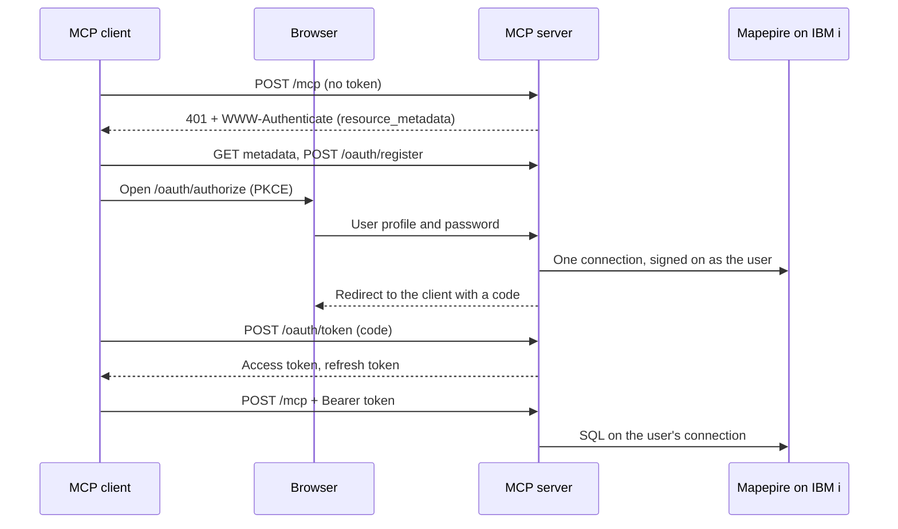

# Built-in IBM i sign-on: security design notes

For maintainers and security reviewers. Operators read `docs/server-config/oauth-ibmi-signon.mdx` (setup) and `docs/server-config/oauth-reference.mdx` (settings). This file keeps the detail behind them: what is stored where, what an attacker needs, what the design does not protect against, the sign-on budget, and what has been tested.

## How It Works

- **One sign-on is one connection.** Submitting the form makes exactly one sign-on attempt on the IBM i. On success the open connection (one IBM i database server job) belongs to that sign-on. Nothing is retried.
- **The password is not kept in clear.** Before the server drops the typed password it encrypts it. The key is never stored in clear either: it is kept only wrapped under a key derived from the authorization code and then from the client's current refresh token. The server keeps neither the code nor a refresh token, so it alone cannot decrypt the password.
- **Idle connections are closed.** After `OAUTH_IDLE_CLOSE_MINUTES` (default 10) without a request to the MCP endpoint, the server closes the connection and its IBM i job ends. A token refresh is not such a request: a client that only refreshes is closed as idle too. The sign-on itself stays.
- **The refresh after a refused request reopens the connection.** The first MCP request after an idle close gets `401` with `error_description="connection closed, refresh"`. The client then presents its refresh token at `/oauth/token`. That token unwraps the key, the server decrypts the password, makes one sign-on attempt, and erases the decrypted bytes. The user is not prompted. The new connection gets a full idle period. A refresh that no such `401` came before rotates the tokens and signs nothing on: a client that only refreshes keeps no connection open and causes no sign-on on the IBM i. It is a new database server connection, but the IBM i may run it in a prestart `QZDASOINIT` job it used before, so the job name can repeat.
- **A sign-on lasts at most `OAUTH_GRANT_MAX_HOURS`** (default 12). After that the user signs on again.
- **Nothing is written to disk.** A restart of the server signs everyone out.

Access tokens live `OAUTH_IDLE_CLOSE_MINUTES` plus five minutes (15 minutes by default). They carry no key material: an access token alone cannot reopen a closed connection.

## What Is Stored Where

**In the MCP server process (memory only):**

| Item | Form | Lifetime |
|------|------|----------|
| Password | AES-256-GCM ciphertext under a random key made for that sign-on | Until the sign-on ends, then overwritten with zeros |
| That key | Only wrapped (AES-256-GCM) under a key derived with HKDF-SHA256 from the authorization code (60 seconds), then the current refresh token, and the previous refresh token until it is retired | In clear only while sealing, re-wrapping or reconnecting |
| Authorization codes, access tokens, refresh tokens | SHA-256 hashes, plus the replay record below. The issued code exists as a string only while the redirect that carries it is built; a second submission of the form gets a page without it. | Until they expire or the sign-on ends |
| Replay record of the last refresh | The new access token and the new refresh token, AES-256-GCM under a key derived with HKDF-SHA256 from the previous refresh token. The server alone cannot open it. | Until the previous refresh token is retired |
| The open connection | A WebSocket to Mapepire. It holds no user name and no password. | While the user's client sends MCP requests, plus the idle time. Refreshes alone neither keep it open nor reopen it. |
| Sign-on failure counters | Keyed by an HMAC of the profile name under a random per-process key | Until a success, an unblock or a restart |

The typed password exists in clear as bytes during the sign-on request and during each reconnect. The copies the server's own code makes are kept outside the JavaScript heap and outside Node.js's shared buffer pool, and are overwritten with zeros when the request finishes. Authorization codes and refresh tokens a client presents are handled the same way, and so is the body of each token response, which is overwritten once Node.js has written it, or at once when the client went away before it was ready. Memory the server's own code does not hold is not overwritten:

- **Node.js's HTTP read buffer.** Node.js reads every incoming request into one buffer that lives as long as the process and is reused without being cleared. The body of the last sign-in form, password included, stays in it until a later request at least as long overwrites it. The same holds for the body of the last token request, with its authorization code or refresh token. On a quiet server that is the password of the last user who signed on, for as long as the process runs. This was observed with the plain-HTTP listener (a proxy in front); the server's own TLS listener was not examined.
- **Buffers inside Node.js's crypto and TLS code**, for example the copy a key derivation makes of a code or a refresh token, are freed or left to the garbage collector, not overwritten.
- **Two strings.** The server builds the `Authorization` header of the WebSocket upgrade from the password, and the redirect to the client (its `Location` header, or the page that redirects) from the new authorization code. A string cannot be overwritten; nothing refers to either after the request or the response is sent.

The server holds no service account password, no token-signing key and no encryption key at rest. When `MCP_TLS_KEY_FILE` is set it holds the private key of its own TLS listener.

**On the wire:**

- Browser to server: the password once per sign-on, in the body of the form `POST`, inside TLS. It is never in a URL. A TLS-terminating proxy in front of the server sees it in clear.
- Server to Mapepire: `Authorization: Basic` on one WebSocket upgrade per connection, inside TLS. The server verifies Mapepire's certificate first, unless `DB2i_IGNORE_UNAUTHORIZED=true` turns that off (see Setup). It is sent again at each reconnect.
- Client to server: the access token on every MCP request, the refresh token only in `/oauth/token` request bodies.

**On the IBM i:**

**mapepire-server keeps each connected user's password in the memory of its Java job for as long as that user's connection is open.** This server cannot change that. It limits the time: a connection is open while the user's client sends MCP requests, plus `OAUTH_IDLE_CLOSE_MINUTES`. Token refreshes alone do not reopen it. Whoever can dump or control the Mapepire job on the IBM i can read the passwords of the users connected at that moment, without touching the MCP server.

This statement, and the IBM i setup below that follows from it, come from reading the mapepire-server 2.5.1 source and IBM documentation. They were not tested on an IBM i system for this release.

Each connection runs in a database server job under the user's own profile. No secret of the MCP server is stored on the IBM i.

**In the MCP client:** the access token and the refresh token. The refresh token is one half of what is needed to decrypt the stored password. Alone it yields access tokens, never the password.

**In the user's browser:** nothing from this server. The browser may offer to save the password for the sign-in page's origin.

## What an Attacker Needs to Recover a Password

After a user has signed on, recovering that user's password takes one of:

- code execution inside the MCP server process while the user is connected, or when the user's client next refreshes;
- a dump of the Mapepire job on the IBM i while the user's connection is open;
- a full memory image of the MCP server process that still contains a current or previous refresh token of that sign-on next to the ciphertext, or the password itself: in freed memory that was not reused yet, or in Node.js's HTTP read buffer, which holds the last sign-in form until a longer request overwrites it;
- a memory image taken while a connection is open, together with a recording of that connection's TLS traffic;
- with `DB2i_IGNORE_UNAUTHORIZED=true`: a position on the network between the server and the IBM i, from which to answer in Mapepire's place;
- the user's browser password store, if the user saved the password there.

Not enough on their own: an access token; a refresh token, which opens the stored password only together with the server's memory; and the server's log files, its disk, a backup or its container image, which hold no password, ciphertext or key. A test in this repository (`packages/server/tests/ibmi-mcp-server/oauth/memory.test.ts`) takes a V8 heap snapshot after a sign-on, a tool call, an idle close and a refresh, and checks that no string in it contains the test password, the authorization code or a refresh token.

## What It Does Not Protect Against

- **Code execution in the MCP server process, or root on its host or on a TLS-terminating proxy in front of it.** That attacker can run SQL on every open connection, capture passwords typed while present, and decrypt a stored password as soon as its client refreshes.
- **Someone on the IBM i who can dump or control the Mapepire job**, and an administrator of the IBM i or of mapepire-server. They receive every password at sign-on and at each reconnect.
- **Anyone who can impersonate the Mapepire server, when `DB2i_IGNORE_UNAUTHORIZED=true`.** The server then sends each password, at sign-on and at every reconnect, to whatever answers at `DB2i_HOST`, without checking its certificate. Someone on the network path, or who controls name resolution or routing for that host, receives the passwords in clear.
- **A full memory image or core dump of the server.** It can hold the password of the last user who signed on, however long ago that was (see Node.js's HTTP read buffer under What Is Stored Where), and what it takes to decrypt the stored password of a user who signed on or refreshed recently. Disable core dumps for the service or container.
- **A sign-in link built by an attacker who shares the victim's network address** (same machine, same NAT or VPN address) or who runs a program on the victim's machine. For other attackers the code exchange is bound to the address that signed on; that binding does not apply when you set `OAUTH_CODE_ADDRESS_BINDING=audit` or list a non-loopback redirect URI.
- **A stolen access token** while the connection is open and the token is unexpired: SQL as that user. **A stolen refresh token**: SQL as that user until `OAUTH_GRANT_MAX_HOURS` or revocation.
- **Hostile SQL in a YAML tool file.** It runs with the signed-on user's authority.
- **Statements that keep running.** A statement abandoned after 120 seconds may continue on the IBM i.
- **Someone inside the allowed network blocking sign-on for a named profile** by submitting wrong passwords (see Sign-On Budget and Unblocking). Only an unblock or a restart refills the budget. A restart forgets every count, so two rejected attempts, a restart and one more can add up to three failed sign-ons on the IBM i.
- **Someone inside the allowed network filling the table of sign-on counts** with 10,000 made-up profile names, each rejected once. Until a restart, a profile that has not signed on since the server started is then refused with "Another sign-on is in progress", and nothing is sent for it. Profiles that have signed on since the start, and so every sign-on that holds a grant, still sign on and reconnect, and no count is forgotten.
- **More failed sign-ons than `OAUTH_SIGNON_MAX_FAILURES` when Mapepire's answers cannot be read.** While Mapepire answers a sign-on late, drops the connection or answers with a text the server does not recognise, the server forwards up to twice `OAUTH_SIGNON_MAX_FAILURES` attempts for a profile (4 by default) before it blocks the profile, and each may have been counted as failed on the IBM i.
- **One failed sign-on on the IBM i when a password is changed** while no connection is open and the user has not signed on here again: the next reconnect uses the old password, is rejected, and ends the sign-ons of that profile that hold that password. If Mapepire does not answer that reconnect, or answers with a text the server does not recognise, the old password is sent a second time before those sign-ons end. A new sign-on with the new password ends the earlier sign-ons first, so nothing stale is sent.
- **A look-alike sign-in page on another origin**, and passwords saved in a browser.

## Sign-On Budget and Unblocking

The IBM i acts on a profile after `QMAXSIGN` failed sign-ons; what it does (disable the profile, the device, or both) is the system value `QMAXSGNACN`. The server keeps its own, smaller budget per profile, which bounds how many failed sign-ons the sign-in page can add to that count.

`OAUTH_SIGNON_MAX_FAILURES` bounds how many rejected sign-ons **this server forwards** for one profile. It may not equal what the IBM i counts. Reading the mapepire-server source (every 2.x release except 2.3.6) suggests that one rejected `connect` may be tried by more than one registered JDBC driver, so the IBM i may count more than one failed attempt for one wrong password. This has not been confirmed on a system. Check `QMAXSIGN` and `QMAXSGNACN` on your IBM i before you rely on the default.

| Result of a sign-on attempt | Counted | What the page says |
|-----------------------------|---------|--------------------|
| The IBM i rejected it (wrong password, unknown profile) | Yes | `Sign-on not accepted.` |
| Password expired, profile disabled (recognised only when the Mapepire job runs in English) | No | Says which, and what to do |
| Mapepire itself refused the profile | No | Not permitted through Mapepire |
| IBM i unreachable before a connection opened | No | System unavailable |
| Connection opened, then no answer in 20 seconds, the connection dropped, or an error the server does not recognise | Soft count, and towards the block at twice the maximum: the IBM i may have counted a failed sign-on | System unavailable |
| Profile or password has a shape that cannot sign on (see Limitations) | No, nothing is sent | Says which rule |

- **Hard budget.** After `OAUTH_SIGNON_MAX_FAILURES` (default 2) rejected attempts with no success between them, nothing more is sent to the IBM i for that profile. The count does not decay with time. Reconnects count too.
- **Results the server could not read.** A sign-on that was sent and then not answered, dropped, or answered with an error the server does not recognise may have been counted as failed on the IBM i. These results are counted together with the rejections, also without decay: after twice `OAUTH_SIGNON_MAX_FAILURES` sign-ons (default 4) with no success between them the profile is blocked in the same way. With the defaults the server forwards at most 2 sign-ons that the IBM i rejected and at most 4 that it may have rejected, until the profile is unblocked or the server restarts. No count is forgotten before then (see 10,000 profiles below). Where `QMAXSIGN` is 3 and 4 is too many, set `OAUTH_SIGNON_MAX_FAILURES=1`: the bounds are then 1 and 2.
- **Soft budget.** Two soft-counted results in 30 minutes pause that profile for 30 minutes.
- **Reconnects with a stored password.** Two reconnects of one profile in a row whose result the server could not read end the sign-ons of that profile that hold the same password, so that password is not sent a third time.
- **One at a time.** One sign-on per profile and four in total may be in flight; another gets "Another sign-on is in progress".
- **10,000 profiles.** The server keeps counts for at most 10,000 profiles. When it holds that many, it makes room only by forgetting a profile that holds nothing that counts: no rejection, no result it could not read, no soft-counted result inside the 30-minute window, and no pause or block. When there is no such profile, a profile that has signed on successfully since the server started (every profile that holds a sign-on has) still gets an entry, beyond the 10,000; there can be no more of those than profiles that have signed on. Any other profile is then refused with "Another sign-on is in progress", and nothing is sent to the IBM i for it, until room is made or the server restarts. Reconnects of existing sign-ons are never refused for want of room.

A blocked user sees: *Sign-on for this user profile is blocked on this server after sign-on attempts that were rejected or not answered. The IBM i profile is not disabled by this block. Sign on at a 5250 session first, then ask the operator of this server to unblock the profile.* Signing on at a 5250 session first resets the IBM i's own count.

A block is cleared by `unblock` on the admin socket or by a restart of the server. `unblock` also lifts the profile's pause and empties its 30-minute window. Without `OAUTH_ADMIN_SOCKET`, only a restart clears it.

## IBM i Setup

Because mapepire-server holds the password of every connected user in its job, the following is required on the IBM i, not optional:

- **Run Mapepire under a dedicated user profile** that nobody signs on as.
- **Exclude `*PUBLIC`** from that profile's home directory and its `.mapepire` directory, and **change the keystore passwords** from the published default. Whoever can read the keystore can impersonate the Mapepire server.
- **Export the certificate you pin on the IBM i** from that keystore; do not fetch it over the network.
- **Exclude `*PUBLIC` from the directories JVM dumps are written to.** Remove `*PUBLIC` authority from the `GENJVMDMP` command and from `QSYS2.SET_JVM` unless the site needs them, and **review who holds `*JOBCTL`**: according to IBM's documentation that special authority is enough to dump another job's JVM.
- **Do not start Mapepire with `-Dcodeserver.jdbc.autoconnect=true`.** According to the mapepire-server source, releases 2.3.2 to 2.4.x then sign on again with the same wrong password when the socket closes, so one wrong password costs a second failed sign-on. This server cannot see that setting.
- **Leave Mapepire's trace levels at their defaults**, and run mapepire-server 2.3.2 or later: earlier 2.x builds let any connected client read other connections' trace output.
- **Check `QMAXSIGN` and `QMAXSGNACN`** against `OAUTH_SIGNON_MAX_FAILURES`; see Sign-On Budget and Unblocking.
- **Tell users which passwords cannot be used here**: one that contains `:` or `%`, or begins with `*` (see Limitations).
- **Leave `OAUTH_ALLOW_PRIVILEGED_PROFILES` off** unless you accept that a security officer's password sits in the Mapepire job while that officer is connected.

On the MCP server host: run the server under its own user, mount the certificate and tool files read-only, and disable core dumps.

**What the security officer sees.** Each connection is a database server job under the user's own profile, so authority checks, job logs and object auditing name the user. A user who works in bursts produces a new connection after each idle close (prestart jobs are reused, so it may carry a job name seen before). The connect request names the application `ibmi-mcp/<grantId>`, and the same `grantId` is in the server's log lines, which joins an IBM i job to the MCP client, the redirect destination and the user's network address. According to the mapepire-server source, Mapepire connects to the database on `localhost`, so exit programs and rules that look at the client's IP address see a local connection, not the user's address.

## Operations

**Restarts.** A restart or a new deployment signs everyone out and clears every sign-on block. On a normal stop (`SIGTERM`) the server closes each user's IBM i job and cuts the sign-ons that are still in progress.

**Password changes.** When a password is changed or a profile disabled on the IBM i, an open connection is expected to keep working (not tested). On the next token refresh with an open connection the server re-reads the profile: a profile that is no longer `*ENABLED` ends that sign-on, and a changed password ends every sign-on of the profile that was made with the old one. If no connection is open, the next reconnect is rejected by the IBM i and ends those sign-ons. When the user signs on again with the new password, the server compares the profile's password change date and ends the profile's earlier sign-ons at once, without sending their old password.

## What Has and Has Not Been Tested

Tested in this repository, against an in-process stand-in for Mapepire and with the MCP TypeScript SDK client (`@modelcontextprotocol/client` 2.4.0):

- the whole flow: challenge, metadata, registration, sign-in, code exchange, tool calls as the user, idle close, the `401`, refresh and reconnect, revocation;
- a client that only refreshes after an idle close: no sign-on reaches the stand-in until its next call is answered `401`;
- two users at once on separate connections; the sign-on budget; the server's own TLS listener;
- a Mapepire that answers `404` to every HTTP request other than the WebSocket upgrade, as 2.3.2 does; a sign-on with `DB2i_IGNORE_UNAUTHORIZED=true` to a Mapepire whose certificate is self-signed and expired, and that nothing is sent to it without that setting;
- both texts a rejected sign-on can have (`...:PROFILE)` and `...:USER:PROFILE CPFxxxx)`), each counted against the sign-on budget;
- that a registration with the redirect URIs VS Code sends is answered with its two loopback URIs. This tests the server's answer, not VS Code.

Run by hand end to end against one IBM i system (IBM i 7.4, mapepire-server 2.3.2 with an expired certificate and `DB2i_IGNORE_UNAUTHORIZED=true`, the SDK client, outside this repository's tests):

- startup and the certificate warning; both metadata documents; the `401`, registration and the sign-in page; one sign-on with a real profile, the code exchange, and every built-in tool and the `performance.yaml` tools running as that profile with `CURRENT CLIENT_APPLNAME` `ibmi-mcp/<grantId>`; `execute_sql` refusing a `DELETE`; six parallel calls on one sign-on;
- the idle close, the `connection closed` `401`, the SDK refreshing, and the reconnect. The IBM i history log shows exactly two sign-ons for the whole run (sign-on and reconnect). The reconnect ran in the same `QZDASOINIT` job number as before, because the database server reuses its prestart jobs;
- `--admin status` and `--admin revoke`, after which the client's refresh is refused; a security officer profile refused without `OAUTH_ALLOW_PRIVILEGED_PROFILES`; the profile's invalid sign-on count staying 0; no password or token in the server's output.

Also checked on that system: a wrong password is answered with the `...:PROFILE)` text. The 2.4 and 2.5 behaviour comes from reading their sources.

Not tested:

- **Failure paths on a real IBM i system.** The sign-on result classes other than a wrong password (in particular on a Mapepire job that does not run in English, with other `jt400` levels, and the `...:USER:PROFILE CPFxxxx)` text, which was not observed on a system), how many failed sign-ons the IBM i counts per rejected attempt (see Sign-On Budget and Unblocking), what `-Dcodeserver.jdbc.autoconnect=true` does to that count, whether an ordinary user can read their own row in `QSYS2.USER_INFO_BASIC` (if not, every sign-on is refused as privileged until `OAUTH_ALLOW_PRIVILEGED_PROFILES=true`), expired passwords and disabled profiles, and whether a JVM dump of the Mapepire job shows passwords.
- **Any MCP client other than the SDK client**: Claude Code, Claude Desktop, VS Code, Cursor, MCP Inspector and others. Whether each completes the sign-on, and whether it answers the `connection closed` `401` by refreshing, is not known.
- **A real browser.** The form post and the redirect back to the client were exercised with scripted requests.
- **A real reverse proxy**, an OpenShift Route, and a deployment whose `MCP_RESOURCE_URL` has a path prefix (`https://apps.example.com/ibmi/mcp`).
- **The server's full process memory.** The memory test covers the V8 heap and Node.js's shared Buffer pool, with OpenTelemetry off. No test scans the rest of the process. One scan was made by hand during review (macOS, plain-HTTP listener); it is where the copy in Node.js's HTTP read buffer was seen (see What Is Stored Where).

